# Unity 2D

## Lesson 10-11: Підготовка папки зі скриптами

На першому скріншоті видно, що в папці `Assets > Scripts > DialogSystem` уже створені всі основні файли для системи діалогу. Саме тут зручно тримати все, що стосується NPC, діалогів і менеджера показу тексту.

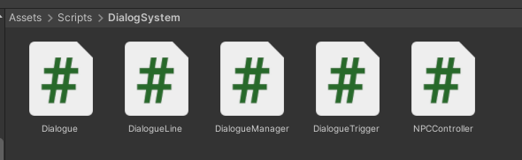

У цій папці знаходяться такі файли:

`Dialogue`  
`DialogueLine`  
`DialogueManager`  
`DialogueTrigger`  
`NPCController`

Це і є основа майбутньої системи.

---

# 📦 СКРІПТИ (З ПОЯСНЕННЯМ)

## 📄 Dialogue.cs

```csharp
using UnityEngine; // підключаємо Unity для ScriptableObject

[CreateAssetMenu(fileName = "NewDialogue", menuName = "Dialogue/Dialogue")] // додає пункт Create → Dialogue
public class Dialogue : ScriptableObject // створюємо asset для діалогу
{
    public DialogueLine[] lines; // масив реплік
}
```

---

## 📄 DialogueLine.cs

```csharp
using UnityEngine; // підключаємо Unity

[System.Serializable] // щоб Unity показував це в інспекторі
public class DialogueLine // одна репліка
{
    public string speakerName; // ім’я персонажа

    [TextArea(2, 5)] // велике поле тексту
    public string text; // текст репліки
}
```

---

## 📄 DialogueManager.cs

```csharp
using System.Collections.Generic; // для Queue
using UnityEngine; // база Unity
using UnityEngine.UI; // для Text

public class DialogueManager : MonoBehaviour // менеджер діалогу
{
    public static DialogueManager Instance; // глобальний доступ

    public GameObject dialoguePanel; // панель
    public Text speakerText; // ім’я
    public Text dialogueText; // текст

    private Queue<DialogueLine> lines = new Queue<DialogueLine>(); // черга

    private void Awake() // при старті
    {
        Instance = this; // зберігаємо інстанс
        dialoguePanel.SetActive(false); // ховаємо панель
    }

    private void Update() // кожен кадр
    {
        if (dialoguePanel.activeSelf && Input.GetKeyDown(KeyCode.Space)) // якщо відкрито і пробіл
        {
            ShowNextLine(); // наступна репліка
        }
    }

    public void StartDialogue(Dialogue dialogue) // старт діалогу
    {
        dialoguePanel.SetActive(true); // показуємо UI
        lines.Clear(); // очищаємо

        foreach (var line in dialogue.lines) // додаємо всі репліки
        {
            lines.Enqueue(line);
        }

        ShowNextLine(); // перша репліка
    }

    public void ShowNextLine() // наступна
    {
        if (lines.Count == 0) // якщо кінець
        {
            EndDialogue(); // закриваємо
            return;
        }

        var line = lines.Dequeue(); // беремо наступну

        speakerText.text = line.speakerName; // ім’я
        dialogueText.text = line.text; // текст
    }

    public void EndDialogue() // кінець
    {
        dialoguePanel.SetActive(false); // ховаємо
    }
}
```

---

## 📄 DialogueTrigger.cs

```csharp
using UnityEngine;

public class DialogueTrigger : MonoBehaviour, IInteractable // NPC взаємодія
{
    public Dialogue dialogue; // діалог

    public void Interact(GameObject interactor) // при натисканні E
    {
        Debug.Log("Interacted by: " + interactor.name); // лог
        DialogueManager.Instance.StartDialogue(dialogue); // запуск
    }
}
```

---

## 📄 NPCController.cs

```csharp
using UnityEngine;

public class NPCController : MonoBehaviour
{
    public Animator animator; // аніматор
    public float detectionRadius = 3f; // радіус
    public Transform player; // гравець

    private bool isPlayerNear = false; // стан

    private void Update()
    {
        float distance = Vector2.Distance(transform.position, player.position); // дистанція

        if (distance <= detectionRadius) // якщо близько
        {
            if (!isPlayerNear)
            {
                isPlayerNear = true;
                animator.SetBool("CanTalk", true); // включає анімацію
            }
        }
        else
        {
            if (isPlayerNear)
            {
                isPlayerNear = false;
                animator.SetBool("CanTalk", false); // назад idle
            }
        }
    }
}
```

---

## Крок 2. Додавання NPC на сцену та підготовка анімації

На другому скріншоті видно NPC на сцені з назвою `NPC_Dialog`. Також відкрито вкладку Animation, де обирається кліп для персонажа. Тут готується анімація, яка буде вмикатися, коли персонаж знаходиться поруч і з ним можна поговорити.

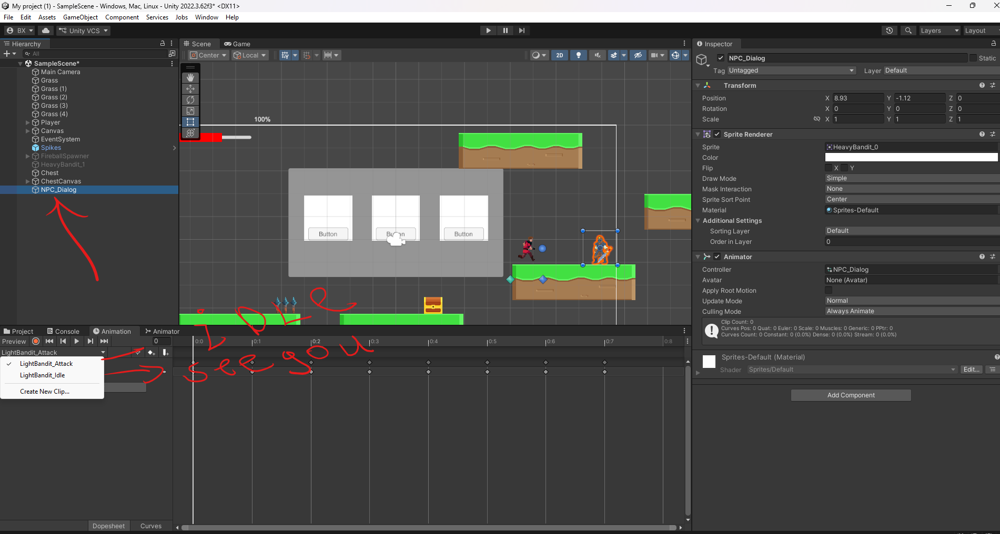

На цьому етапі важливо, щоб NPC уже був окремим об’єктом на сцені, мав спрайт і Animator. У списку кліпів видно анімації персонажа. Саме з них буде побудовано поведінку для станів спокою та стану готовності до діалогу.

---

## Крок 3. Створення параметра CanTalk в Animator

На третьому скріншоті показано вікно Animator. Тут створюється параметр `CanTalk`. Саме він перемикає NPC між звичайним станом і станом, коли персонаж реагує на наближення гравця.

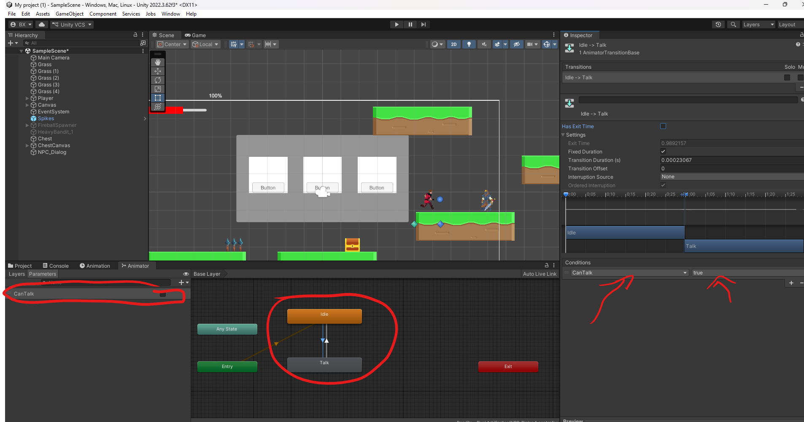

Усередині Animator є два стани:

`Idle`  
`Talk`

Між ними створюються переходи. Для переходу з `Idle` у `Talk` використовується умова, коли `CanTalk = true`. Це означає, що гравець підійшов досить близько.

---

## Крок 4. Налаштування переходу Idle → Talk

На четвертому скріншоті відкриті налаштування переходу з `Idle` у `Talk`. Тут використовується умова `CanTalk = true`.

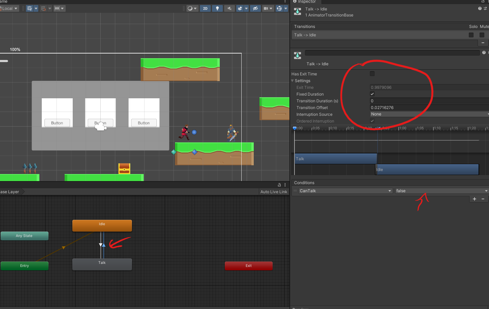

На цьому кроці перевіряється, щоб перехід відбувався саме по умові, а не випадково. Це дозволяє NPC міняти поведінку лише тоді, коли гравець підійшов до нього.

---

## Крок 5. Налаштування переходу Talk → Idle

На п’ятому скріншоті відкрито зворотний перехід. Тут використовується умова `CanTalk = false`.

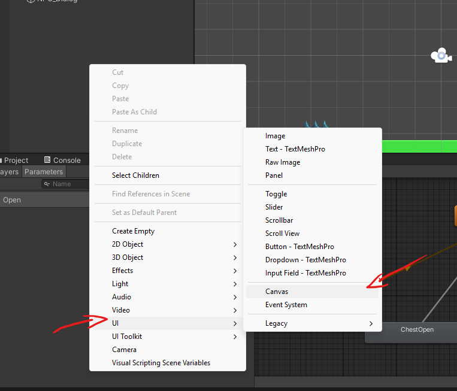

Коли гравець відходить від NPC, параметр повертається у false, і персонаж переходить назад у `Idle`. Таким чином створюється проста, але зрозуміла реакція NPC на присутність гравця.

---

## Крок 6. Створення Canvas для діалогу

На шостому скріншоті показано створення нового UI Canvas через меню Unity. Саме в ньому буде розміщена панель діалогу.

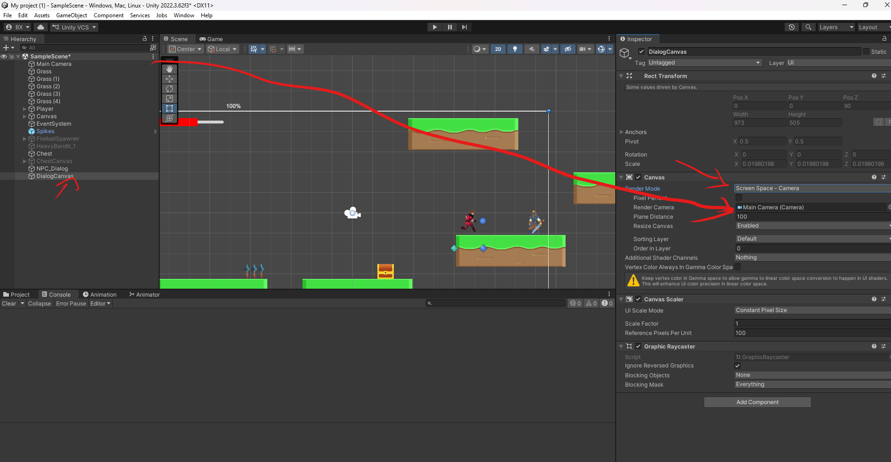

Після створення Canvas він стане контейнером для всього інтерфейсу діалогу. Це окремий UI шар, який відображається поверх ігрової сцени.

---

## Крок 7. Налаштування Canvas

На сьомому скріншоті видно новий `DialogCanvas`. У нього налаштований режим відображення `Screen Space - Camera`, а також прив’язана `Main Camera`.

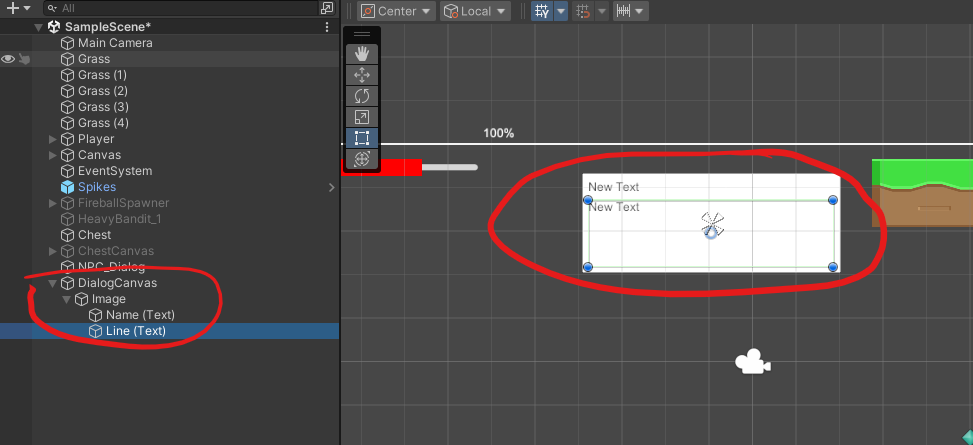

Це означає, що UI діалогу буде коректно відображатися через основну камеру гри. Такий варіант добре підходить для 2D сцени, де треба бачити інтерфейс поверх ігрового поля.

---

## Крок 8. Створення панелі та текстів усередині Canvas

На восьмому скріншоті показана структура `DialogCanvas`. Усередині нього створено `Image`, а вже в ньому два текстові елементи:

`Name (Text)`  
`Line (Text)`

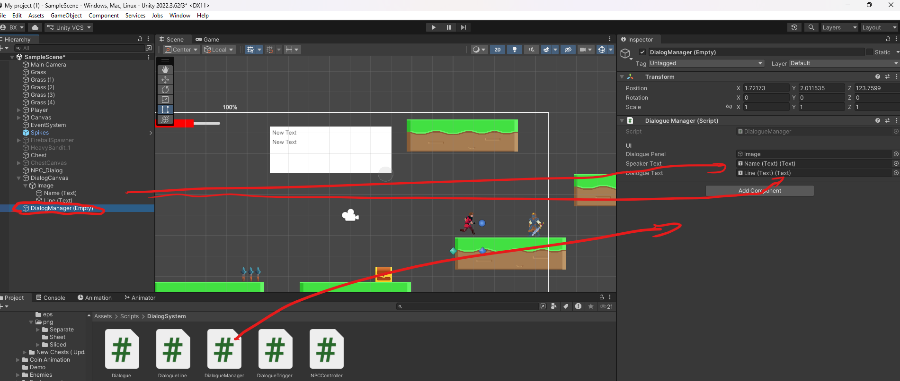

`Image` виконує роль фону діалогу.  
`Name (Text)` показує ім’я мовця.  
`Line (Text)` показує саму репліку.

Саме ця структура згодом буде підключатися до менеджера діалогів.

---

## Крок 9. Створення об’єкта DialogueManager на сцені

На дев’ятому скріншоті створений порожній об’єкт `DialogueManager (Empty)`. На нього додається компонент `DialogueManager`, а в поля цього компонента прив’язуються елементи з Canvas.


На цьому етапі важливо правильно підключити:

`Dialogue Panel` → `Image`  
`Speaker Text` → `Name (Text)`  
`Dialogue Text` → `Line (Text)`

Тепер менеджер знає, який саме UI відкривати та куди записувати ім’я і текст.

---

## Крок 10. Створення окремої папки для asset діалогів

На десятому скріншоті видно, що в папці `DialogSystem` створюється окрема папка `DialogsNPC`.

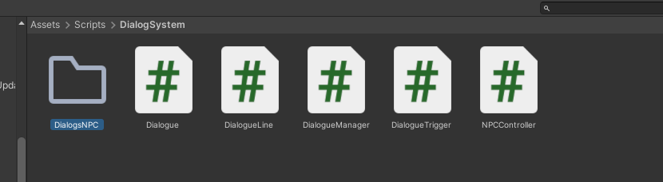

Це зручно для порядку в проєкті. У цій папці будуть зберігатися всі ScriptableObject діалоги для NPC.

---

## Крок 11. Створення нового діалогу через Create

На одинадцятому скріншоті показано меню Create, де є пункт `Dialogue > Dialogue`.

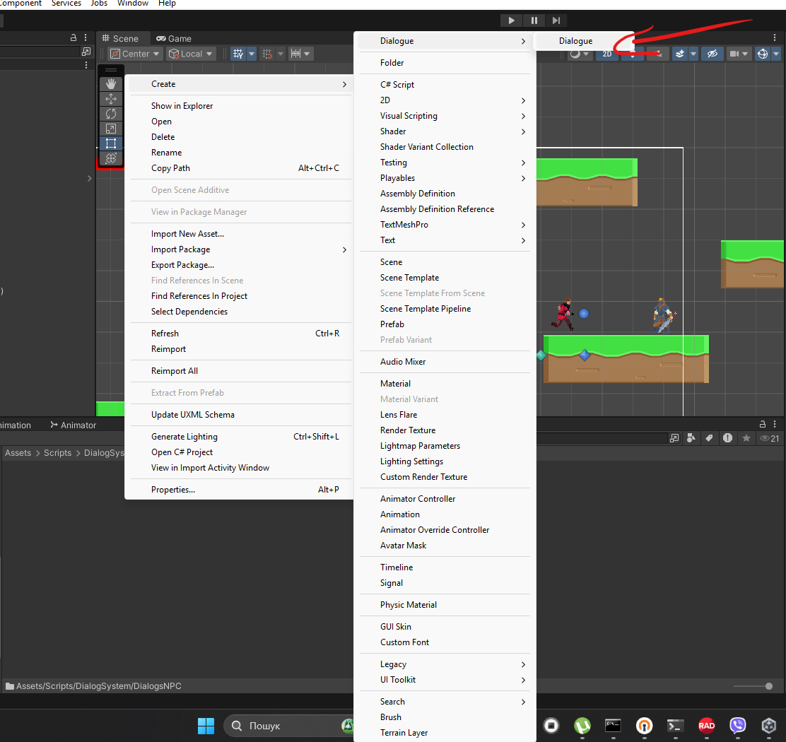

Саме тут створюється новий asset діалогу. Після створення можна дати йому зрозумілу назву, наприклад під конкретного NPC.

---

## Крок 12. Заповнення реплік у ScriptableObject

На дванадцятому скріншоті відкритий створений діалог. Видно масив `Lines`, у якому вже додані кілька реплік з різними іменами та текстом.

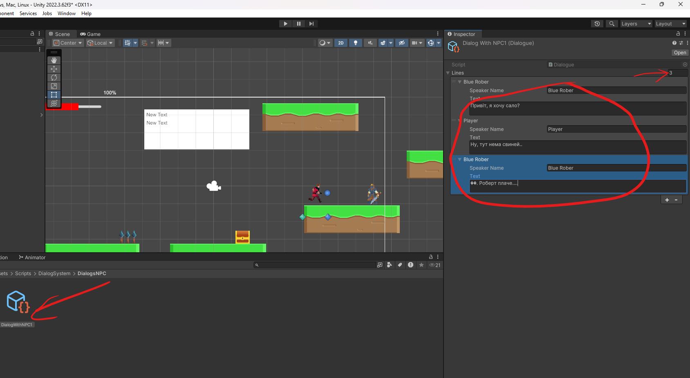

Тут по черзі записуються всі рядки діалогу.  
Кожен елемент це одна репліка.  
Для кожної репліки задається:

ім’я того, хто говорить  
текст репліки

Таким способом діалог стає повністю редагованим через інспектор, без жорсткого запису в коді сцени.

---

## Крок 13. Підключення компонентів до NPC

На тринадцятому скріншоті знову відкрито `NPC_Dialog`. У Inspector видно два важливі компоненти:

`NPC Controller (Script)`  
`Dialogue Trigger (Script)`

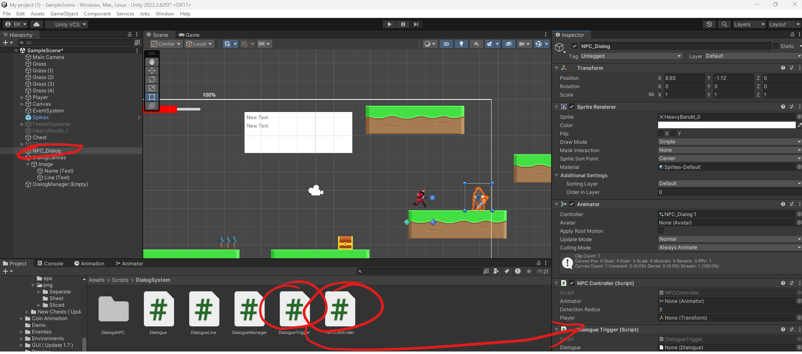

У `NPC Controller` потрібно вказати:

Animator  
Player  
Detection Radius

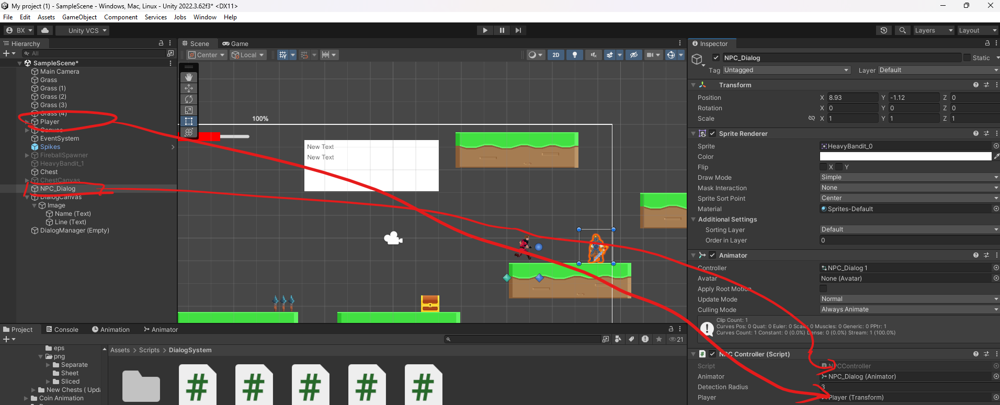

У `Dialogue Trigger` потрібно вказати:

Dialogue

Саме тут NPC отримує посилання і на анімацію наближення, і на конкретний діалог.

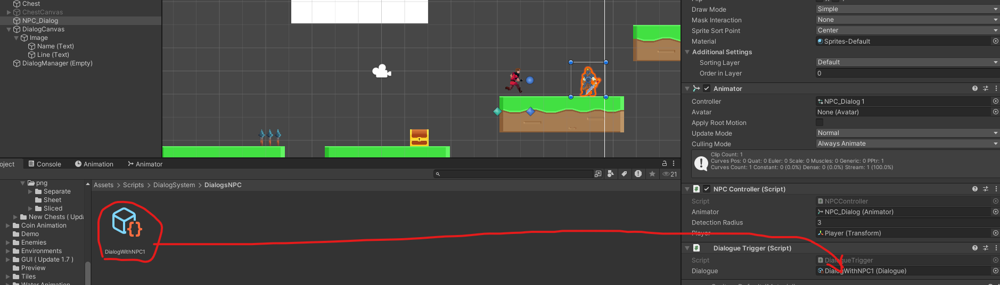

Перенесіть для активації діалога діалог у відповідне місце.
---

## Крок 14. Прив’язка Player, Animator і правильного шару Interactable

На чотирнадцятому скріншоті видно підсумкове налаштування. У `NPC_Dialog` вибраний шар `Interactable`. Також до `NPC Controller` уже прив’язаний гравець і Animator.

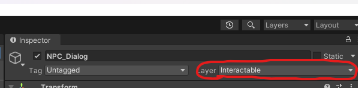

Це фінальний крок з боку Inspector.

Після цього система працює так:

NPC знаходиться на шарі, який бачить система взаємодії  
NPC має колайдер для виявлення  
NPC реагує на наближення через Animator  
NPC має підключений ScriptableObject діалогу  
UI діалогу вже прив’язаний до менеджера

---

## Результат

Після проходження всіх цих кроків виходить така логіка:

гравець підходить до NPC  
NPC змінює анімацію, бо гравець поруч  
натискання клавіші взаємодії запускає діалог  
з’являється панель з іменем і текстом  
перехід між репліками відбувається через керування, яке вже налаштоване в менеджері діалогу

---

## Готова структура сцени

У фіналі в сцені є такі головні частини:

`NPC_Dialog` з Animator, Collider, NPCController і DialogueTrigger  
`DialogCanvas` з Image, Name Text і Line Text  
`DialogueManager` як окремий керуючий об’єкт  
`DialogWithNPC1` як ScriptableObject asset з репліками

---

## Що вийшло

У підсумку зібрана повноцінна базова система діалогу для Unity 2D, де:

NPC можна анімувати при наближенні  
діалоги зберігаються окремими assets  
інтерфейс діалогу винесений у Canvas  
менеджер централізовано показує ім’я й текст  
кожному NPC можна прив’язати свій окремий діалог