# Урок Unity 2D Parkour
## Крок 1. Пошук безкоштовних ассетів в Unity Asset Store

---

## Мета кроку

Підготувати базу для створення 2D паркур гри:
- знайти **оточення (Environment)**
- знайти **персонажа (Character)**
- обидва пакети повинні бути **безкоштовні**

---

## Перехід в Unity Asset Store

Перейдіть за посиланням:
https://assetstore.unity.com/

---

## Крок 1. Обрати категорію 2D

В Asset Store відкрийте:

```

2D → Environments

```

Приклад:

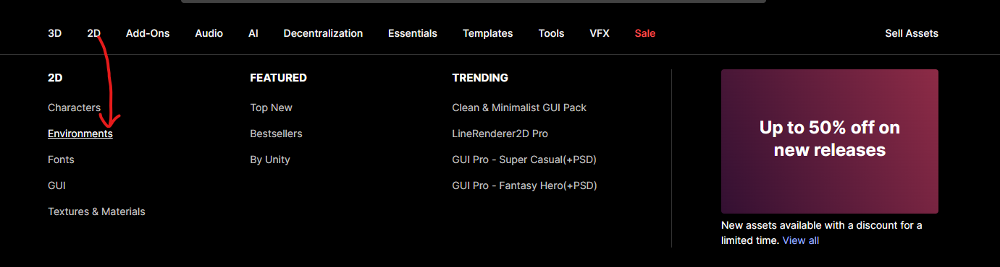

---

## Крок 2. Вибрати безкоштовні ассети

У фільтрах справа увімкніть:

```

Pricing → Free Assets

```

Приклад безкоштовного ассету:

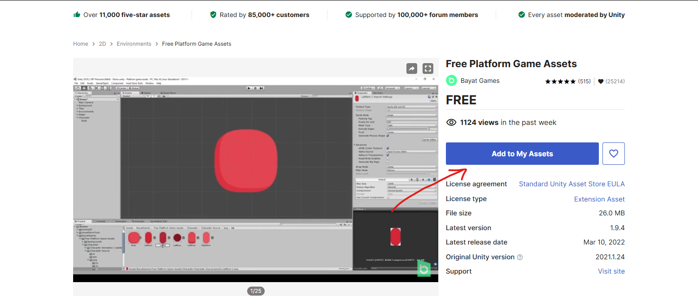

---

## Крок 3. Завантажити Environment Pack

Виберіть будь-який пак, який вам подобається:
- Pixel Forest
- Platformer Tiles
- Parallax Backgrounds
- Nature Pixel Pack
- або будь-який інший

Головне:
- стиль повинен подобатись
- пак безкоштовний

---

## Крок 4. Завантажити Character Pack

Перейдіть:

```

2D → Characters

```

Приклад:

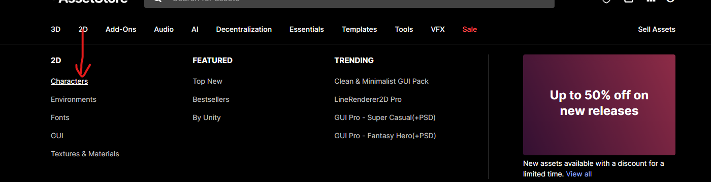

---

## Що потрібно знайти

### Environment Pack
Використовується для:
- платформ
- землі
- дерев
- фону
- декорацій

### Character Pack
Використовується для:
- гравця
- анімацій бігу
- стрибків
- idle анімації

---

## Важливо

Обидва пакети повинні бути:
- FREE
- 2D
- підходити під один стиль (бажано)

---

# Крок. Створення нового 2D проекту в Unity

## Що потрібно зробити

1. Відкрийте **Unity Hub**

2. Перейдіть у вкладку  
   **Projects**

3. Натисніть  
   **New Project**

---

## Приклад

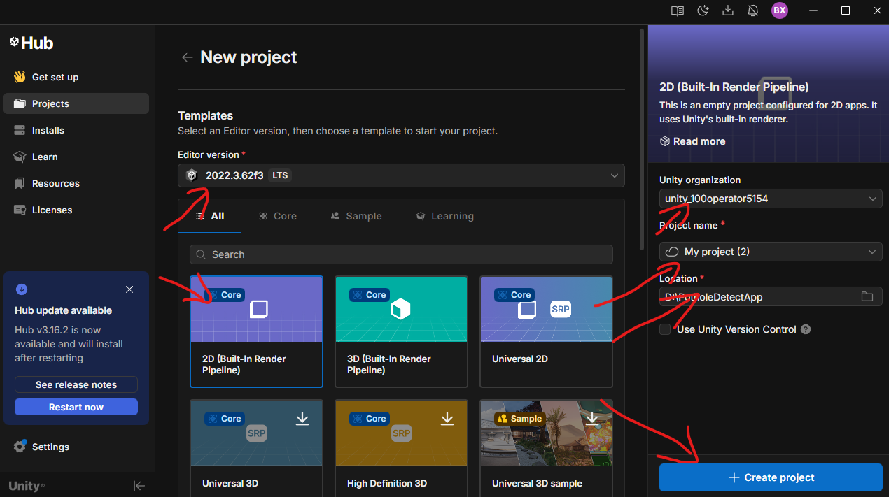

---

## Налаштування проекту

Виберіть:

**Template:**  
`2D (Built-In Render Pipeline)`

**Editor Version:**  
Рекомендовано LTS версію (наприклад 2022 LTS)

**Project Name:**  
Введіть назву вашого проекту

**Location:**  
Виберіть папку, де буде збережений проект

---

## Завершення

Натисніть кнопку:

```

Create Project

```
# Крок. Імпорт ассету з Asset Store в Unity

## Що потрібно зробити

1. Поверніться на сторінку ассету в **Unity Asset Store**

2. Натисніть кнопку  
**Add to My Assets**


---

3. Натисніть  
**Open in Unity**

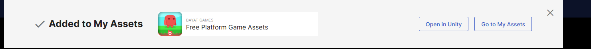

---

4. Якщо браузер запитає, натисніть  
**Відкрити Unity Editor**

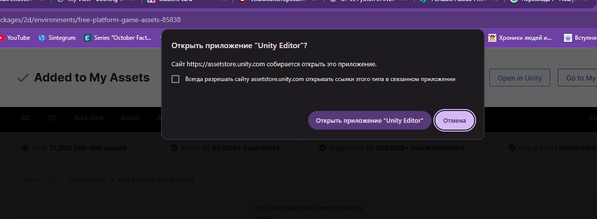

---

## В Unity

5. Відкриється Package Manager

Знайдіть ваш ассет і натисніть:

**Download**

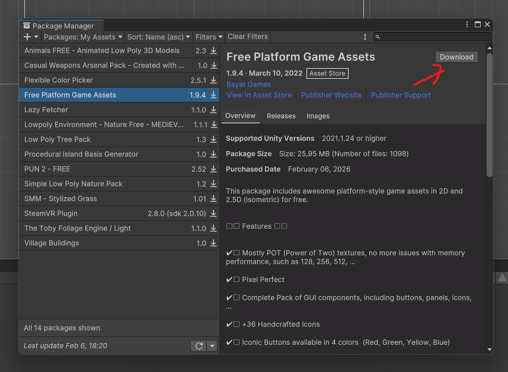

---

6. Після завантаження натисніть:

**Import**

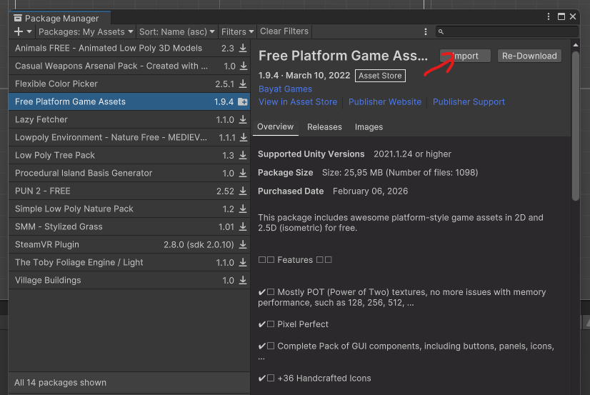

---

7. У вікні **Import Unity Package** перевірте вибрані файли й натисніть **Import**:

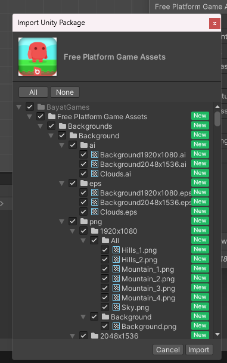

---

## Важливо

Повторіть ці ж кроки для другого ассету з Asset Store.

---

Після імпорту ассет зʼявиться у папці **Assets** у вашому проекті.


# Крок. Панелі Unity Editor та створення міні паркуру

## Що потрібно зробити

Вивчіть основні панелі Unity Editor та створіть просту сцену міні паркуру з імпортованих ассетів.

---

## Приклад розташування панелей

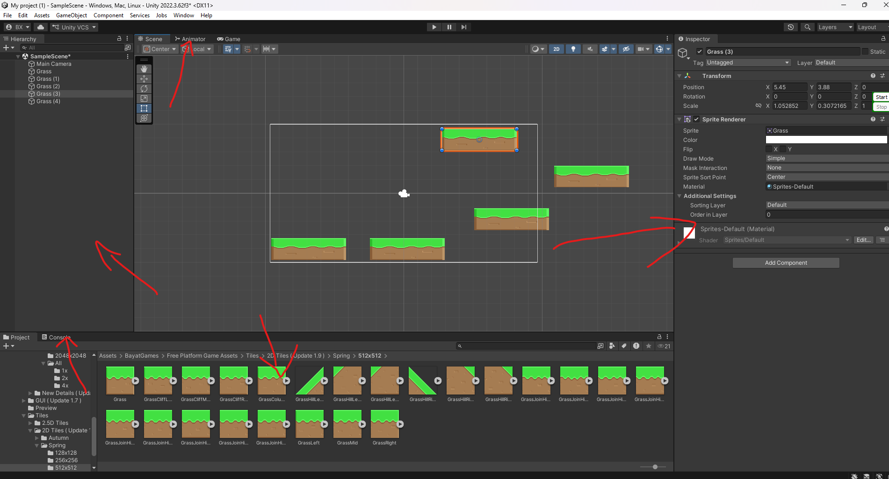

---

## Основні панелі

### Hierarchy
Показує всі обʼєкти сцени.  
Тут видно камеру, спрайти платформ та інші обʼєкти.

---

### Scene
Робоча область сцени.  
Тут розташовуються платформи та будується рівень.

---

### Inspector
Показує налаштування вибраного обʼєкта.  
Тут можна змінювати позицію, масштаб, матеріали, спрайти.

---

### Project
Містить всі ассети проекту.  
Звідси перетягуються спрайти в сцену.

---

## Завдання

Створіть міні паркур:

1. Перетягніть кілька платформ (Grass / Tiles) у Scene  
2. Розташуйте їх на різній висоті  
3. Зробіть платформу старту і платформу фінішу  
4. Розташуйте платформи так, щоб між ними можна було стрибати

---

Головна задача:  
Зрозуміти, яка панель за що відповідає, і навчитися розкладати рівень зі спрайтів.


# Крок. Додавання персонажа на сцену

## Що потрібно зробити

Додайте персонажа зі скачаного Character Pack на сцену.

---

## Як додати персонажа

1. Відкрийте панель **Project**

2. Знайдіть папку з персонажем  
(зазвичай Character / Player / Sprites)

3. Знайдіть спрайт персонажа (Idle або Base)

4. Перетягніть спрайт:
- або в **Scene**
- або в **Hierarchy**

---

## Що відбудеться

Unity автоматично:
- створить GameObject
- додасть Sprite Renderer
- відобразить персонажа на сцені

---

## Після додавання

Перевірте:

- Персонаж видно в Scene
- Персонаж видно в Game View
- Персонаж знаходиться на платформі
- Масштаб виглядає нормально

---

Головна задача:  
Персонаж повинен стояти на платформі і бути видимим в камері.

# Крок. Додавання фізики персонажу та платформам

## Що потрібно зробити

Додайте фізику персонажу та колайдери платформам.

---

## Додати компоненти персонажу

1. Виділіть персонажа в **Hierarchy**

2. В панелі **Inspector** натисніть:
```

Add Component

```

3. Додайте:
- **Rigidbody 2D**
- **Polygon Collider 2D**

---

## Приклад

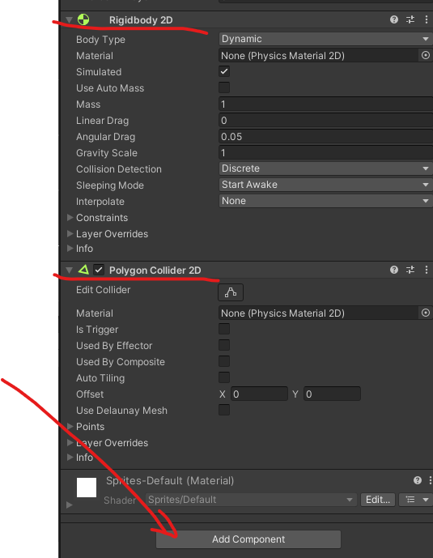

---

## Що роблять ці компоненти

### Rigidbody 2D
Додає фізику:
- гравітацію
- падіння
- рух через фізику

---

### Polygon Collider 2D
Створює форму зіткнення по формі спрайта.

---

## Додати колайдери платформам

1. Виділіть кожен блок (Grass / Tile)

2. Натисніть:
```

Add Component

```

3. Додайте:
- **Box Collider 2D**

---

## Результат

Персонаж:
- падає вниз через гравітацію
- стоїть на платформах

Платформи:
- мають зону зіткнення
- тримають персонажа

---

Головна задача:  
Персонаж повинен падати і стояти на платформах.

# Крок. Налаштування Collider під форму спрайта

## Що потрібно зробити

Перевірте форму Collider персонажа.  
Якщо зелена обводка не співпадає зі спрайтом, її потрібно відредагувати.

---

## Як виглядає Collider

Зелена обводка навколо персонажа це зона зіткнення.

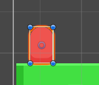

---

## Якщо Collider не співпадає зі спрайтом

Причини можуть бути:
- Collider створився не точно
- У спрайта є прозорий фон
- Форма персонажа не прямокутна

---

## Як виправити

1. Виділіть персонажа
2. В Inspector знайдіть **Polygon Collider 2D**
3. Натисніть кнопку:
```

Edit Collider

```

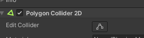

---

## Після натискання Edit Collider

Можна:
- рухати точки колайдера
- додавати точки
- видаляти точки
- повторити форму персонажа

---

## Результат

Collider повинен:
- повторювати форму персонажа
- не заходити далеко в прозору область
- не бути значно більшим за персонажа

---

Головна задача:  
Collider повинен максимально точно повторювати форму персонажа.

# Крок. Створення скрипта PlayerMovement і базовий рух через rb.velocity

В панелі **Project** натисніть правою кнопкою миші по папці, де зберігаєте скрипти, потім виберіть **Create → C# Script**.

Приклад:

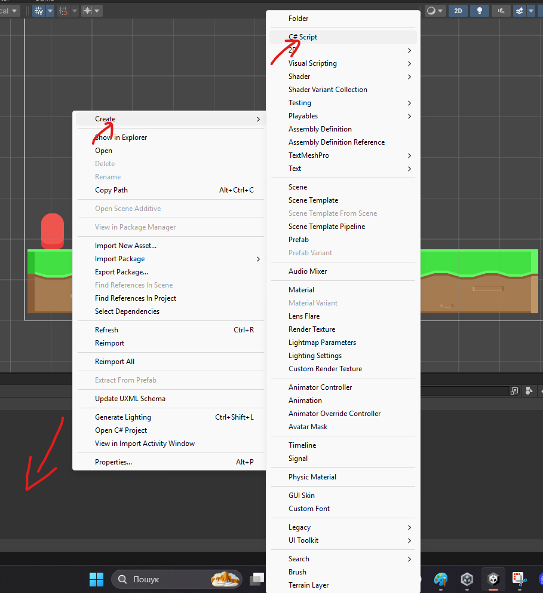

Назвіть скрипт: `PlayerMovement`

Далі відкрийте його та напишіть код нижче.
```csharp
using UnityEngine;

public class PlayerMovement : MonoBehaviour
{
    [Header("References")]
    public Rigidbody2D rb;

    [Header("Movement")]
    public float moveSpeed = 6f;

    [Header("Jump")]
    public float jumpForce = 12f;

    [Header("Ground Checkers")]
    public Transform groundCheckL;
    public Transform groundCheckR;
    public float groundCheckRadius = 0.15f;
    public LayerMask groundLayer;

    private float moveDirection = 0f;
    private bool jumpPressed = false;

    private void Start()
    {
        if (rb == null)
            rb = GetComponent<Rigidbody2D>();
    }

    private void Update()
    {
        moveDirection = 0f;

        if (Input.GetKey(KeyCode.A) || Input.GetKey(KeyCode.LeftArrow))
            moveDirection = -1f;

        if (Input.GetKey(KeyCode.D) || Input.GetKey(KeyCode.RightArrow))
            moveDirection = 1f;

        if (Input.GetKeyDown(KeyCode.Space))
            jumpPressed = true;
    }

    private void FixedUpdate()
    {
        if (rb == null)
            return;

        rb.velocity = new Vector2(moveDirection * moveSpeed, rb.velocity.y);

        if (jumpPressed && CheckGrounded())
        {
            Jump();
            jumpPressed = false;
        }
    }

    public void Jump()
    {
        rb.velocity = new Vector2(rb.velocity.x, jumpForce);
    }

    public bool CheckGrounded()
    {
        bool groundedL = false;
        bool groundedR = false;

        if (groundCheckL != null)
        {
            groundedL = Physics2D.OverlapCircle(
                groundCheckL.position,
                groundCheckRadius,
                groundLayer
            );
        }

        if (groundCheckR != null)
        {
            groundedR = Physics2D.OverlapCircle(
                groundCheckR.position,
                groundCheckRadius,
                groundLayer
            );
        }

        return groundedL || groundedR;
    }

    private void OnDrawGizmosSelected()
    {
        Gizmos.color = Color.green;

        if (groundCheckL != null)
            Gizmos.DrawWireSphere(groundCheckL.position, groundCheckRadius);

        if (groundCheckR != null)
            Gizmos.DrawWireSphere(groundCheckR.position, groundCheckRadius);
    }
}
```
## Налаштування Ground Check і шару Ground

Створіть під об’єктом **Player** два дочірні empty-об’єкти біля лівої та правої ноги: **GroundCheck_L** і **GroundCheck_R**.

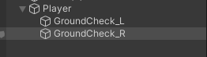

За потреби призначте їм іконки, щоб легше бачити точки у Scene.

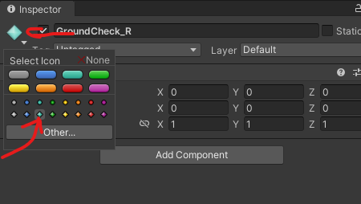

Для платформ створіть шар **Ground** через **Layer → Add Layer...**, введіть його назву й призначте його кожній платформі.

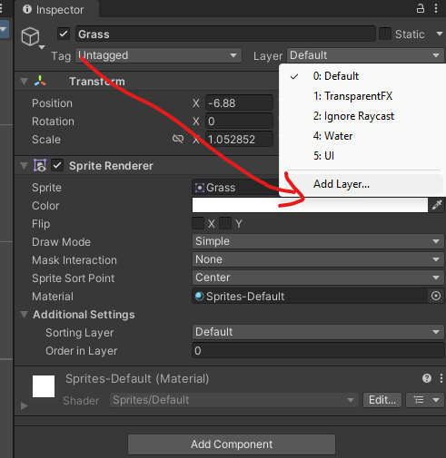

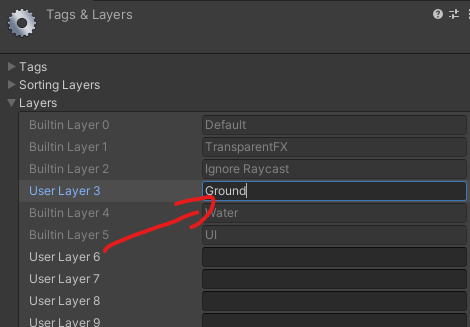

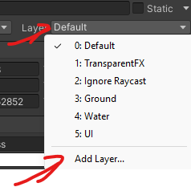

Після додавання скрипта призначте в Inspector **Ground Check L**, **Ground Check R** та **Ground Layer**.

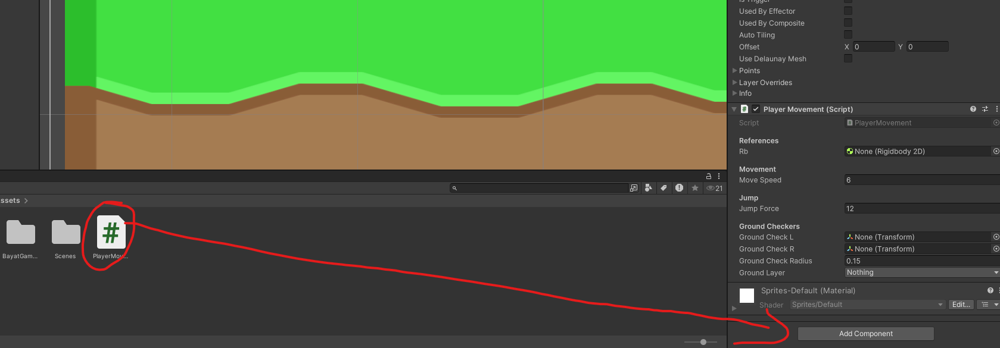

---

# Крок. Відкриття вікон Animator та Animation

## Що потрібно зробити

Активуйте вікна **Animator** та **Animation** у Unity.

---

## Як відкрити

Верхнє меню Unity:

```

Window → Animation → Animation
Window → Animation → Animator

```

---

## Приклад

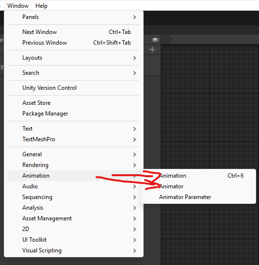

---

## Для чого вони потрібні

### Animation
Тут створюються анімації:
- Idle
- Run
- Jump
- Fall

---

### Animator
Тут створюється логіка переходів між анімаціями:
- Idle → Run
- Run → Jump
- Jump → Fall
- Fall → Idle

---

## Результат

У вас повинні бути відкриті два вікна:
- Animation
- Animator

## Створення анімаційних кліпів

Виберіть **Player** у Hierarchy, у вікні **Animation** натисніть **Create** й створіть кліпи Idle, Walk та Jump.

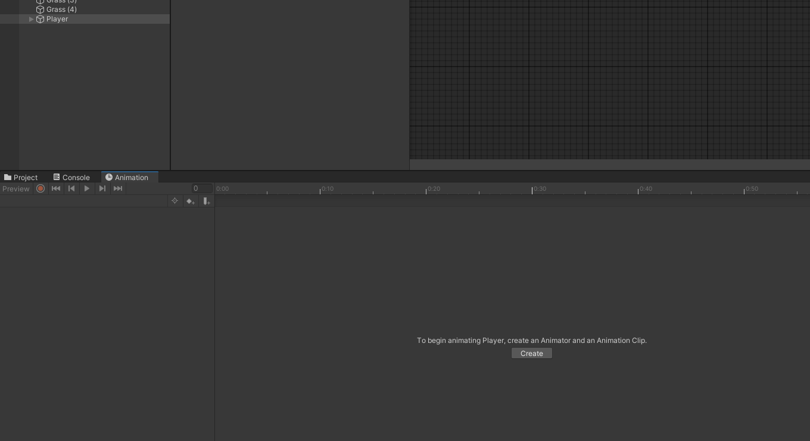

Перемикайте кліпи у списку та додавайте кадри зі спрайтів персонажа.

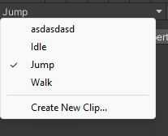

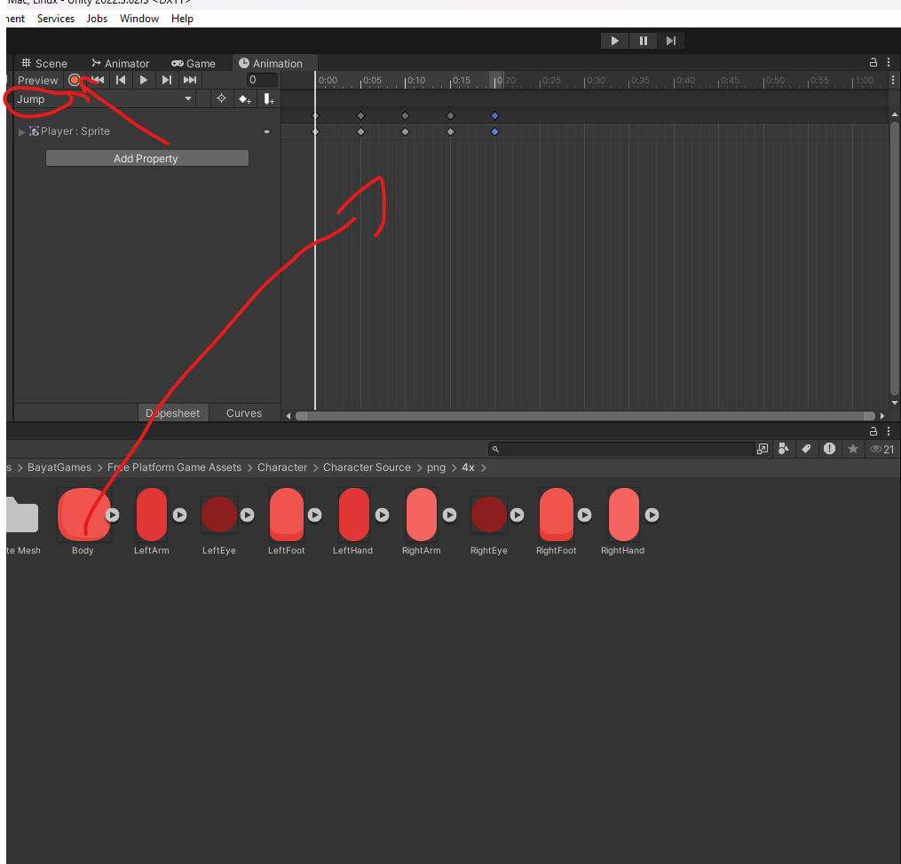

---

# Крок. Налаштування переходів в Animator (Make Transition)

## Що потрібно зробити

У вікні **Animator** створіть переходи між станами, щоб вийшла структура як на прикладі.

---

## Приклад структури

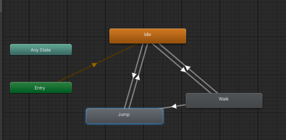

---

## Як створити перехід (Make Transition)

1. У **Animator** натисніть правою кнопкою миші по стану (наприклад, Idle)
2. Оберіть:
```

Make Transition

```
3. Клікніть по стану, куди має вести стрілка (наприклад, Walk)

---

## Які переходи потрібно зробити

Зробіть переходи між цими станами:
- `Idle → Walk`
- `Walk → Idle`
- `Idle → Jump`
- `Jump → Idle`
- `Walk → Jump`
- `Jump → Walk`

---

## Результат

Після цього в Animator повинні бути стрілки між станами як на прикладі.


# Крок. Додавання параметрів Animator (IsWalking, IsJumping)

## Що потрібно зробити

Додайте два параметри в Animator:
- `IsWalking` тип **Bool**
- `IsJumping` тип **Trigger**

---

## Як додати параметри

1. Відкрийте вкладку **Animator**
2. Перейдіть у вкладку **Parameters**
3. Натисніть кнопку:
```

+

```

---

## Додайте параметр ходьби

Тип:
```

Bool

```

Назва:
```

IsWalking

```

---

## Додайте параметр стрибка

Тип:
```

Trigger

```

Назва:
```

IsJumping

```

---

## Приклад

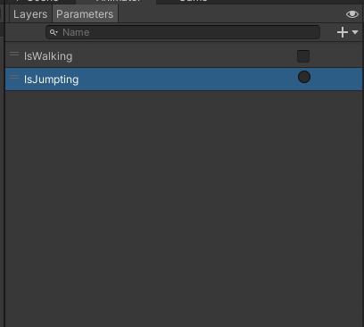

---

## Результат

У Parameters повинно бути:
- IsWalking (Bool)
- IsJumping (Trigger)

# Крок. Налаштування переходів у Jump

## Що потрібно зробити

Налаштуйте всі переходи, які ведуть у стан **Jump**, однаково.

---

## Які переходи налаштувати

Усі переходи:
- Idle → Jump  
- Walk → Jump  

---

## Як налаштувати перехід

Виберіть перехід у Animator  
Потім відкрийте **Inspector**

---

## Налаштування

### Вимкніть
```

Has Exit Time

```

---

### У Conditions додайте
```

IsJumping

```

---

## Приклад

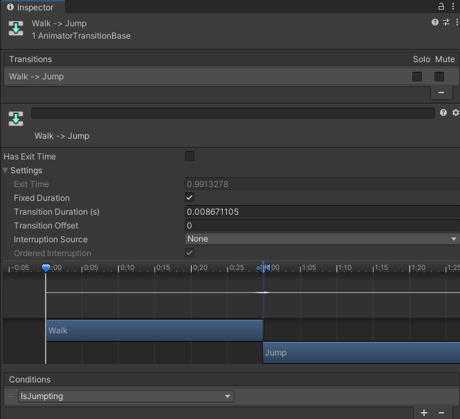

---

## Результат

Стрибок буде запускатися:
- миттєво
- через Trigger IsJumping

# Крок. Налаштування переходів Walk ↔ Idle

## Що потрібно зробити

Налаштуйте переходи:
- Idle → Walk  
- Walk → Idle  

---

## 1) Перехід Idle → Walk

Виберіть перехід **Idle → Walk** у Animator.

### Налаштування

Вимкніть:
```

Has Exit Time

```

У Conditions встановіть:
```

IsWalking = true

```

---

## 2) Перехід Walk → Idle

Виберіть перехід **Walk → Idle**.

### Налаштування

Вимкніть:
```

Has Exit Time

```

У Conditions встановіть:
```

IsWalking = false

```

---

## Приклад

Idle → Walk:

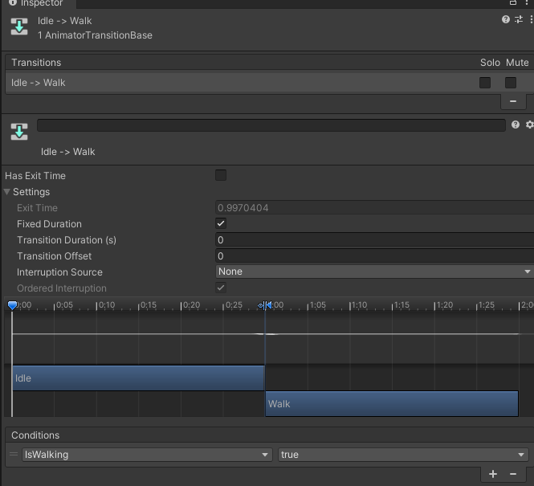

Walk → Idle:

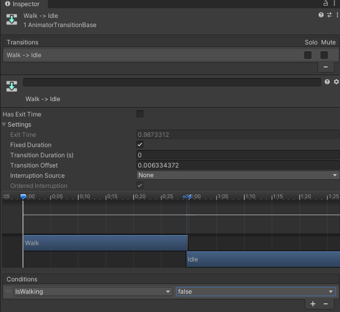

---

## Результат

Анімації будуть перемикатися:
- Почав рухатися → Walk
- Зупинився → Idle


Крок Зміна коду для анімацій. Нижче версія коду з підключеним Animator:

Що додано:

* Animator як public reference
* SetBool("IsWalking") для ходьби
* SetTrigger("IsJumping") при стрибку


---

### Оновлений код

```csharp
using UnityEngine;

public class PlayerMovement : MonoBehaviour
{
    [Header("References")]
    public Rigidbody2D rb;
    public Animator animator;

    [Header("Movement")]
    public float moveSpeed = 6f;

    [Header("Jump")]
    public float jumpForce = 12f;

    [Header("Ground Checkers")]
    public Transform groundCheckL;
    public Transform groundCheckR;
    public float groundCheckRadius = 0.15f;
    public LayerMask groundLayer;

    private float moveDirection = 0f;
    private bool jumpPressed = false;

    private void Start()
    {
        if (rb == null)
            rb = GetComponent<Rigidbody2D>();

        if (animator == null)
            animator = GetComponent<Animator>();
    }

    private void Update()
    {
        moveDirection = 0f;

        if (Input.GetKey(KeyCode.A) || Input.GetKey(KeyCode.LeftArrow))
            moveDirection = -1f;

        if (Input.GetKey(KeyCode.D) || Input.GetKey(KeyCode.RightArrow))
            moveDirection = 1f;

        if (Input.GetKeyDown(KeyCode.Space))
            jumpPressed = true;

        // Анімація ходьби
        if (animator != null)
            animator.SetBool("IsWalking", moveDirection != 0f);
    }

    private void FixedUpdate()
    {
        if (rb == null)
            return;

        rb.velocity = new Vector2(moveDirection * moveSpeed, rb.velocity.y);

        if (jumpPressed && CheckGrounded())
        {
            Jump();

            if (animator != null)
                animator.SetTrigger("IsJumping");

            jumpPressed = false;
        }
    }

    public void Jump()
    {
        rb.velocity = new Vector2(rb.velocity.x, jumpForce);
    }

    public bool CheckGrounded()
    {
        bool groundedL = false;
        bool groundedR = false;

        if (groundCheckL != null)
        {
            groundedL = Physics2D.OverlapCircle(
                groundCheckL.position,
                groundCheckRadius,
                groundLayer
            );
        }

        if (groundCheckR != null)
        {
            groundedR = Physics2D.OverlapCircle(
                groundCheckR.position,
                groundCheckRadius,
                groundLayer
            );
        }

        return groundedL || groundedR;
    }

    private void OnDrawGizmosSelected()
    {
        Gizmos.color = Color.green;

        if (groundCheckL != null)
            Gizmos.DrawWireSphere(groundCheckL.position, groundCheckRadius);

        if (groundCheckR != null)
            Gizmos.DrawWireSphere(groundCheckR.position, groundCheckRadius);
    }
}
```
Після додавання скрипта PlayerMovement на об’єкт Player потрібно обов’язково підключити всі посилання у Inspector. У поле Rb перетягується Rigidbody2D з об’єкта Player. У поле Animator потрібно перетягнути компонент Animator цього ж Player, щоб код міг керувати анімаціями ходьби та стрибка.

Далі потрібно підключити точки перевірки землі. У поля Ground Check L та Ground Check R перетягуються відповідні empty-об’єкти з Hierarchy, які розташовані біля лівої та правої ноги персонажа. Вони використовуються для перевірки, чи персонаж стоїть на землі.

У параметрі Ground Layer потрібно вибрати шар Ground, який ви створювали раніше та призначали всім блокам платформи. Без цього перевірка приземлення працювати не буде.

Якщо всі поля підключені правильно, персонаж зможе рухатися, стрибати та коректно перемикати анімації.
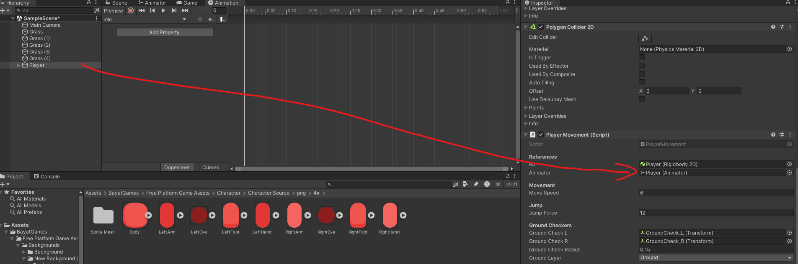


# Тепер запустіть та перевірте!

# Домашнє завдання

Оновіть скрипт **PlayerMovement** так, щоб спрайт персонажа автоматично розвертався у сторону руху.

Коли персонаж рухається вправо, він має дивитися вправо.  
Коли персонаж рухається вліво, він має дивитися вліво.  
Якщо персонаж стоїть на місці, поворот змінювати не потрібно.

Підказка:  
Подумайте, як можна змінювати `localScale` або `flipX` у SpriteRenderer або змінювати знак масштабу по осі X залежно від напрямку руху.

Результат повинен працювати разом з уже реалізованим рухом та анімаціями.
