# Unity 2D  
## Lesson 5–6: Health System and Basic Damage

---

## Мета уроку

У цьому уроці ми:

- створимо систему здоров’я персонажа  
- підключимо UI відображення здоров’я  
- навчимось наносити урон персонажу  
- підготуємо сцену для взаємодії з пастками і ворогами  
- налаштуємо тег Player для правильної роботи скриптів  

---
У Lesson 5–6 ми зробимо:

Health System
Character має HP
HP показується через Slider
HP показується через текст

Basic Damage
Spike наносить урон
Fireball наносить урон
При смерті сцена перезапускається
---

## Частина 1. Підготовка Player для системи урону

Перед тим як працювати з Health System, потрібно правильно налаштувати Player.

Більшість скриптів у грі шукають персонажа через тег Player.  
Якщо тег не встановити, пастки і вороги не будуть працювати.

---

## Що таке Tag в Unity

Tag це спеціальна мітка об’єкта.

Скрипти використовують її щоб зрозуміти:
- хто зіткнувся з об’єктом  
- кому наносити урон  
- хто може активувати тригери  

Наприклад Spike або Fireball можуть перевіряти:
```csharp
if(other.CompareTag("Player"))
````

---

## Крок 1. Обрати Player в Hierarchy

У лівій частині Unity відкрий:

```
Hierarchy
```

Знайди об’єкт:

```
Player
```

Натисни на нього.

Після цього справа відкриється Inspector цього об’єкта.

---

## Крок 2. Встановити тег Player

У верхній частині Inspector знайди поле:

```
Tag
```

Якщо там написано:

```
Untagged
```

Натисни на список і вибери:

```
Player
```

---

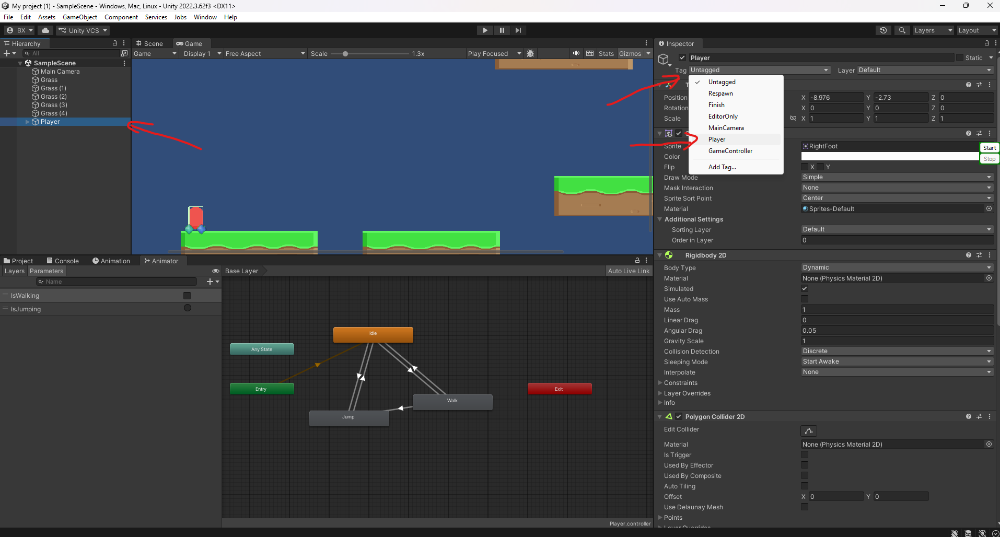
## Чому це важливо для Health System

Наші скрипти урону працюють приблизно так:

```csharp
CharacterHealth health = other.GetComponent<CharacterHealth>();
```

Або так:

```csharp
if(other.CompareTag("Player"))
```

Якщо тег неправильний:

* урон не буде наноситись
* fireball не буде взаємодіяти
* шипи не будуть працювати

---

## Частина 3. Організація скриптів Player

У цьому кроці ми правильно організуємо структуру проєкту та створимо скрипт здоров’я персонажа.

Це важливо, тому що великі проєкти швидко стають складними, якщо скрипти лежать без структури.  
Тому ми одразу привчаємось робити правильну архітектуру папок.

---

### Створення папки для скриптів Player

У вікні Project потрібно створити структуру папок:

```

Assets
└ Scripts
└ PlayerScripts

```

Для цього:

Натиснути правою кнопкою на Assets  
Create → Folder → назвати Scripts  

Потім зайти в Scripts  
Create → Folder → назвати PlayerScripts  

---

### Перенесення існуючих скриптів Player

Якщо у вас вже є скрипти Player, наприклад:

PlayerMovement  
PlayerJump  
PlayerController  

Їх потрібно перетягнути в папку:

```

Assets/Scripts/PlayerScripts

```

---

### Створення нового скрипта PlayerHealth

Тепер потрібно створити новий скрипт:

У папці:
```

Assets → Scripts → PlayerScripts

```

Натиснути:
Right Click → Create → C# Script  

Назвати:
```

PlayerHealth

```

---

### Як це повинно виглядати

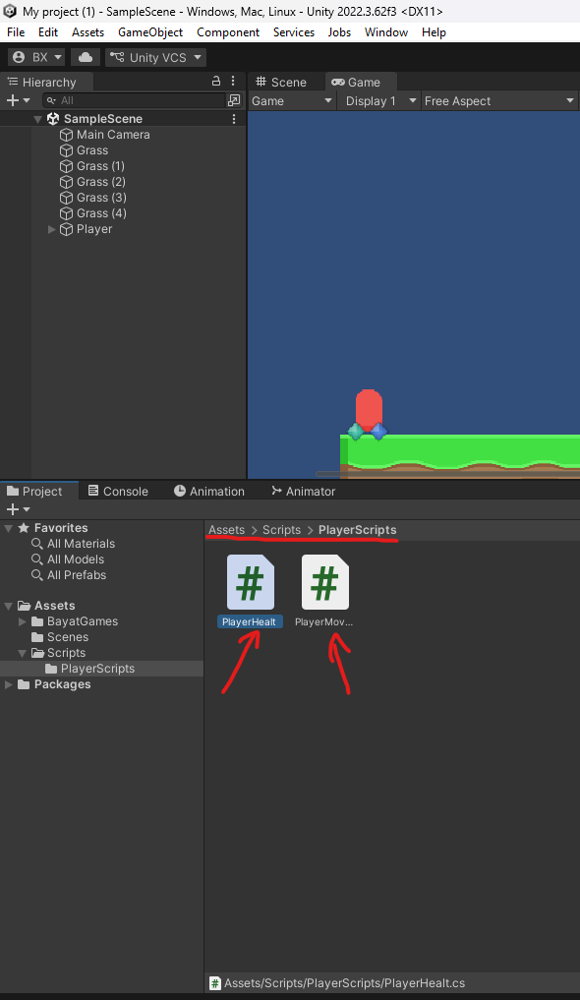

На цьому етапі у папці PlayerScripts вже повинні бути:

PlayerHealth  
PlayerMovement або інші скрипти Player  

---


Відкрийте файл `PlayerHealth` та напишіть цей код.

```csharp
using UnityEngine; // Базові класи Unity
using UnityEngine.UI; // UI елементи, Slider і Text
using UnityEngine.SceneManagement; // Перезапуск сцени

public class PlayerHealth : MonoBehaviour // Скрипт здоров’я персонажа
{
    [Header("Health Settings")] // Заголовок секції в Inspector
    public int maxHealth = 100; // Максимальне HP
    public int currentHealth; // Поточне HP

    [Header("UI")] // Секція UI елементів
    public Slider healthSlider; // Слайдер здоров’я
    public Text healthText; // Legacy UI Text для показу HP

    [Header("Restart Settings")] // Секція налаштувань рестарту
    public float restartDelay = 1.5f; // Затримка перед перезапуском сцени

    private bool isDead = false; // Флаг смерті щоб не викликати повторно

    void Awake() // Викликається при старті сцени
    {
        currentHealth = maxHealth; // Даємо повне здоров’я
        UpdateUI(); // Оновлюємо UI
    }

    public void TakeDamage(int damage) // Метод отримання урону
    {
        if (isDead) return; // Якщо персонаж вже мертвий
        if (damage <= 0) return; // Захист від неправильного урону

        currentHealth -= damage; // Зменшуємо HP

        if (currentHealth <= 0) // Якщо HP закінчилось
        {
            currentHealth = 0; // Фіксуємо 0
            Die(); // Викликаємо смерть
        }

        UpdateUI(); // Оновлюємо UI після зміни HP
    }

    public void Heal(int amount) // Метод лікування
    {
        if (isDead) return; // Мертвого не лікуємо
        if (amount <= 0) return; // Захист від неправильного значення

        currentHealth += amount; // Додаємо HP

        if (currentHealth > maxHealth) // Якщо перевищили максимум
            currentHealth = maxHealth; // Обмежуємо максимумом

        UpdateUI(); // Оновлюємо UI
    }

    public void SetHealth(int value) // Метод прямої установки HP
    {
        if (isDead) return; // Якщо мертвий нічого не робимо

        currentHealth = Mathf.Clamp(value, 0, maxHealth); // Обмежуємо від 0 до maxHealth

        if (currentHealth == 0) // Якщо стало 0
            Die(); // Викликаємо смерть

        UpdateUI(); // Оновлюємо UI
    }

    void Die() // Метод смерті персонажа
    {
        if (isDead) return; // Захист від повторного виклику

        isDead = true; // Позначаємо як мертвого

        Debug.Log("Player died"); // Лог в консоль

        Invoke(nameof(RestartScene), restartDelay); // Викликаємо рестарт через затримку
    }

    void RestartScene() // Перезапуск сцени
    {
        SceneManager.LoadScene(SceneManager.GetActiveScene().buildIndex); // Перезавантажуємо поточну сцену
    }

    void UpdateUI() // Оновлення UI
    {
        if (healthSlider != null) // Якщо Slider підключений
        {
            healthSlider.maxValue = maxHealth; // Встановлюємо максимум
            healthSlider.value = currentHealth; // Встановлюємо поточне значення
        }

        if (healthText != null) // Якщо Text підключений
        {
            healthText.text = currentHealth + " / " + maxHealth; // Виводимо HP текстом
        }
    }

    public bool IsDead() // Метод перевірки смерті
    {
        return isDead; // Повертаємо флаг смерті
    }
}
```
## Частина 4. Додавання PlayerHealth до Player

Тепер потрібно підключити скрипт PlayerHealth до об’єкта Player.

Саме після цього скрипт почне працювати в грі.

---

### Крок 1. Відкрити папку зі скриптом

Відкрийте вікно Project та перейдіть у:

```

Assets → Scripts → PlayerScripts

```

Там повинен бути файл:

```

PlayerHealth.cs

```

---

### Крок 2. Додати скрипт до Player

Знайдіть об’єкт:

```

Player

```

у вікні Hierarchy.

---

Тепер зробіть так:

Перетягніть файл **PlayerHealth**  
з вікна Project  
прямо на Player в Inspector  

---

### Крок 3. Перевірити що компонент створився

Після перетягування в Inspector має з’явитися новий компонент:

```

Player Health (Script)

```

У ньому ви побачите поля:

Health Settings  
Max Health  
Current Health  

UI  
Health Slider  
Health Text  

Restart Settings  
Restart Delay  

---

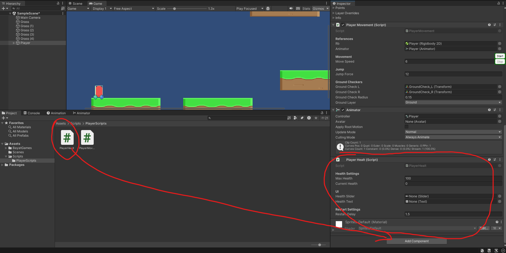

### Як виглядає правильний результат

Якщо все зроблено правильно:

Player має компонент Player Movement  
Player має компонент Animator  
Player має компонент Player Health  

---

### Важливо

Якщо компонент не з’явився:

Перевірте що файл називається PlayerHealth.cs  
Перевірте що назва класу всередині файлу PlayerHealth  
Перевірте що в консолі немає помилок  

---

## Частина 5. Створення Canvas для UI здоров’я

Тепер потрібно створити Canvas.  
Canvas це контейнер для всього UI в грі: текст, слайдери, кнопки.

Без Canvas UI просто не буде відображатися.

---

### Крок 1. Додати Canvas у сцену

У Hierarchy натисніть правою кнопкою на сцену або SampleScene.

Оберіть:

```

UI → Canvas

```

---

### Як це виглядає

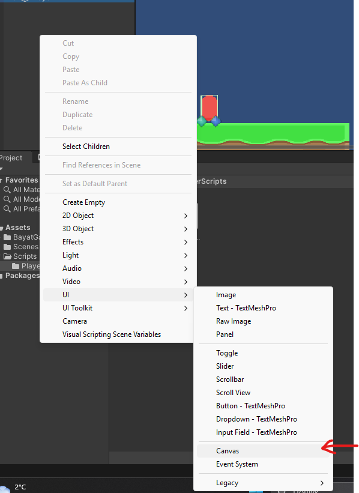

---

Після створення в Hierarchy з’явиться:

```

Canvas
EventSystem

```

EventSystem створюється автоматично. Його видаляти не потрібно.

---

### Крок 2. Налаштувати Canvas

Виділіть Canvas у Hierarchy.

Справа відкриється Inspector.

---

### Крок 3. Змінити Render Mode

Знайдіть поле:

```

Render Mode

```

Перемкніть його на:

```

Screen Space - Camera

```

---

### Крок 4. Підключити камеру

Знайдіть поле:

```

Render Camera

```

Перетягніть туди:

```

Main Camera

```

з Hierarchy.

---

### Як це повинно виглядати

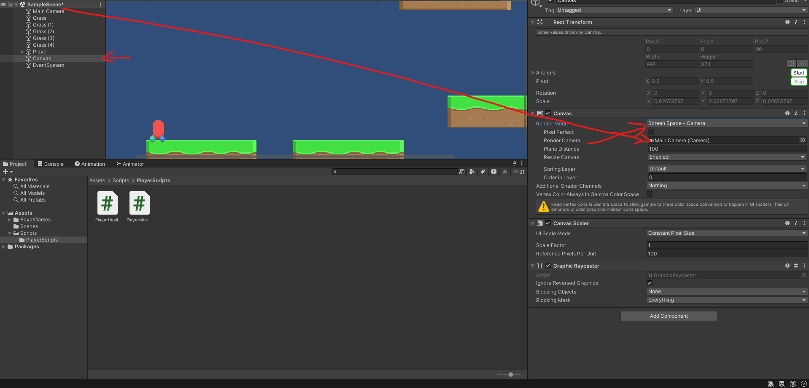

---

### Навіщо це потрібно

Screen Space Camera дозволяє:

прив’язати UI до камери  
коректно показувати UI при русі камери  
правильно працювати з масштабом  

---

### Типові помилки

Canvas залишився в режимі Screen Space Overlay  
UI може працювати некоректно в 2D сценах з камерою  

Не підключена Main Camera  
UI може не відображатися  

---

## Частина 6. Створення HP Bar через Slider

Тепер створимо HP Bar який буде показувати здоров’я гравця.

Ми будемо використовувати Slider як основу, але перетворимо його у звичайний HP Bar.

---

### Крок 1. Додати Slider

Додайте Slider у Canvas.

```

ПКМ по Canvas → UI → Slider

```

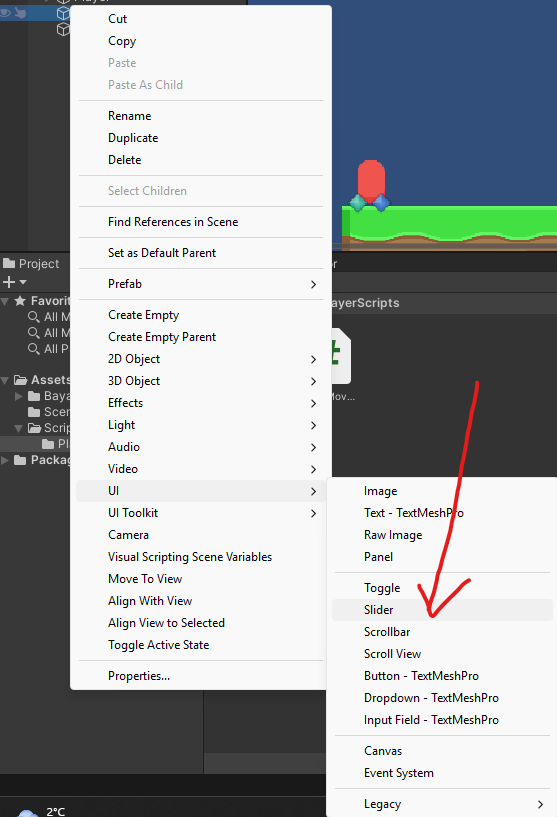

В Anchor Presets виберіть прив’язку до верхнього лівого кута.

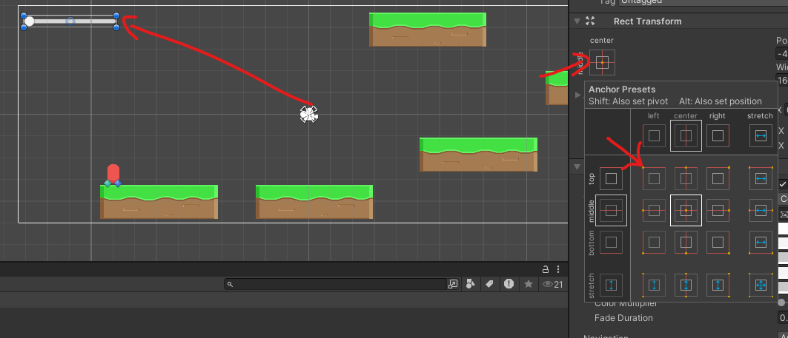

---

### Крок 2. Очистити структуру Slider

Розверніть Slider у Hierarchy.  
Видаліть всі дочірні об’єкти окрім:

```

Background

```

---

### Крок 3. Перейменувати Slider

Перейменуйте Slider у:

```

HPBAR

```

---

### Приклад

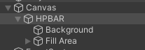

---

### Крок 4. Додати Image для HP

Тепер потрібно створити Image який буде показувати саме HP.

ПКМ по HPBAR → UI → Image

---

### Приклад

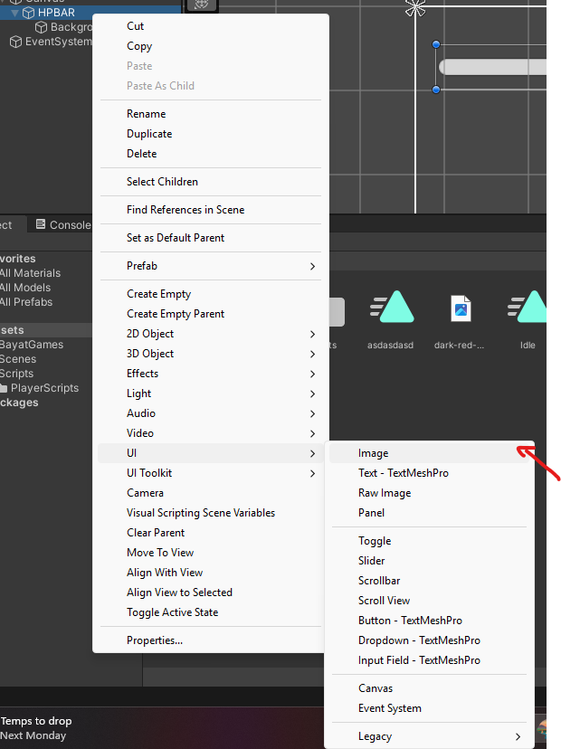

Створіть під **HPBAR** порожній дочірній об’єкт **Fill Area**, перемістіть Image всередину та перейменуйте його на **Fill**:

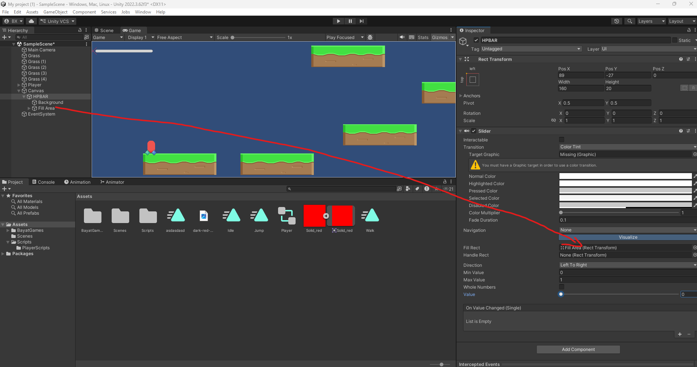

---

### Крок 5. Задати червоний колір HP

Задайте Image червоний колір.

Історично HP у іграх позначають червоним.

---

### Приклад

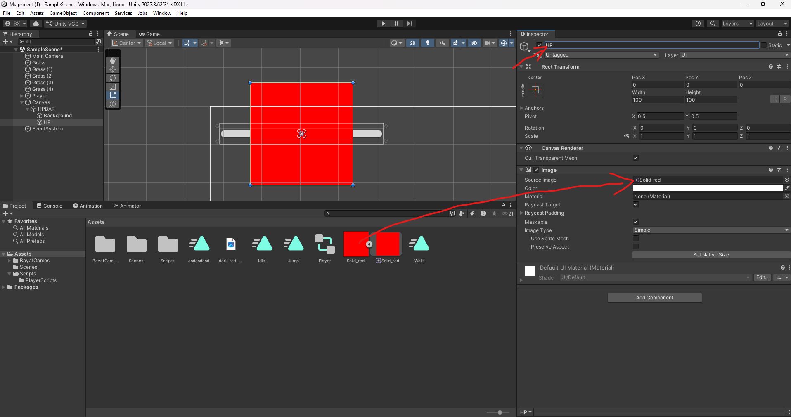

Для дочірнього Fill встановіть червоний Source Image:

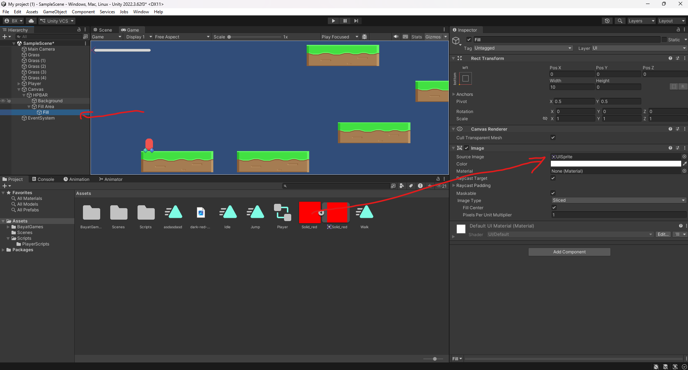

---

### Крок 6. Виставити розмір HP Image

Виставте розмір Image так, щоб він повністю співпадав з Background HP Bar.

---

### Приклад

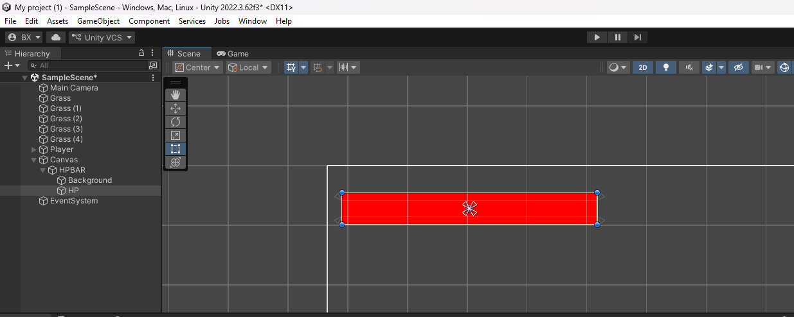

---

### Крок 7. Налаштувати Slider

Виділіть HPBAR.

Змініть:

```

Interactable → OFF
Transition → Color Tint
Value → 1

```

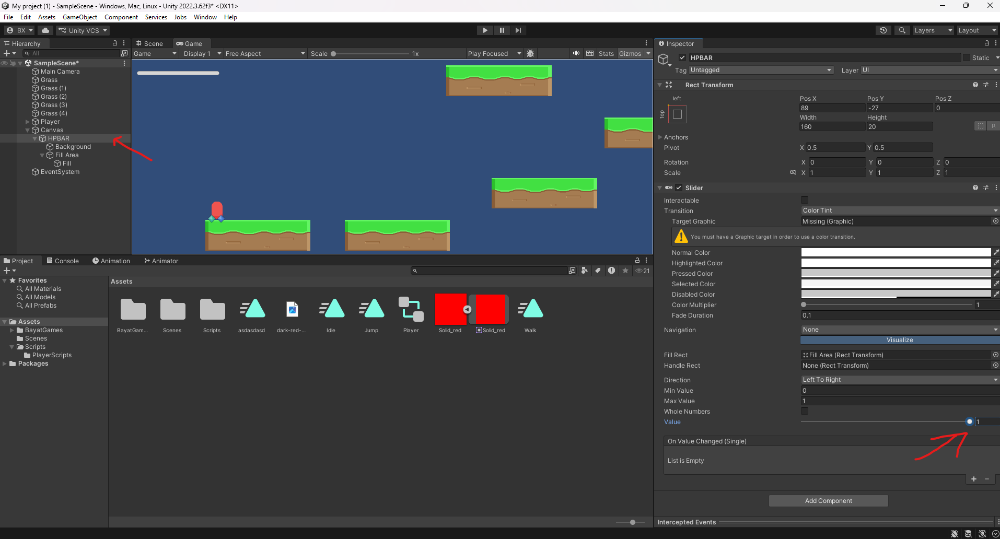

---

### Крок 8. Підключити Fill Rect

Перетягніть HP Image у поле:

```

Fill Rect

```

Після цього HP може виглядати розтягнутим. Це нормально.

---

### Приклад

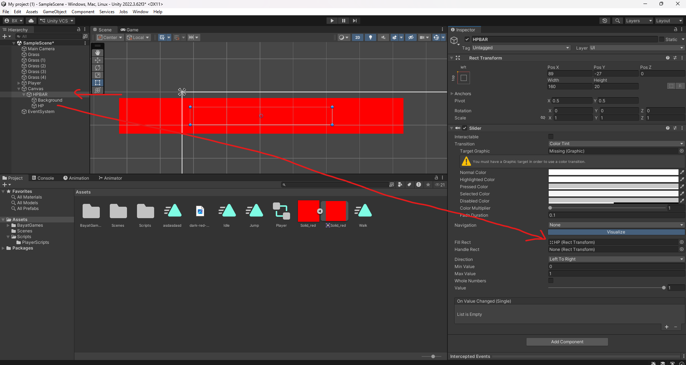

---

### Крок 9. Виправити розмір Fill Image

Знову виставте правильний розмір HP Image.

---

### Приклад

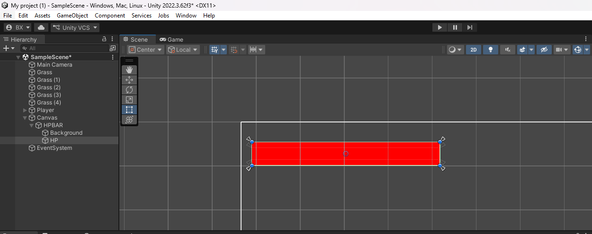

---

### Перевірка роботи HP Bar

Порухайте Value у Slider:

Value = 0 → HP не видно  
Value = 1 → HP повністю перекриває Background  

---

### Приклад фінального результату

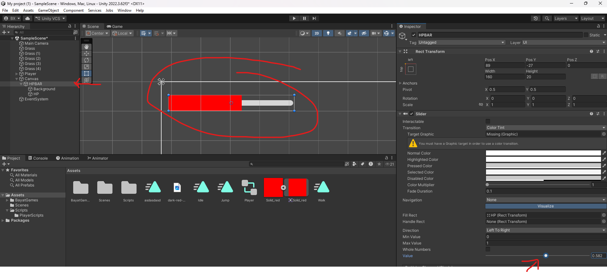

---

### Важливо

При Value = 0 HP не повинно бути видно.  
При Value = 1 HP повністю закриває Background.

Якщо це не так, перевірте розміри HP Image.

---

## Частина 7. Додавання тексту HP через Legacy Text

Тепер додамо текст який буде показувати здоров’я у відсотках поруч з HP баром.

Ми використовуємо саме Legacy Text, тому що в цьому проєкті ми не беремо TextMeshPro.

---

### Крок 1. Додати Legacy Text

На Canvas додайте:

```

UI → Legacy → Text

```

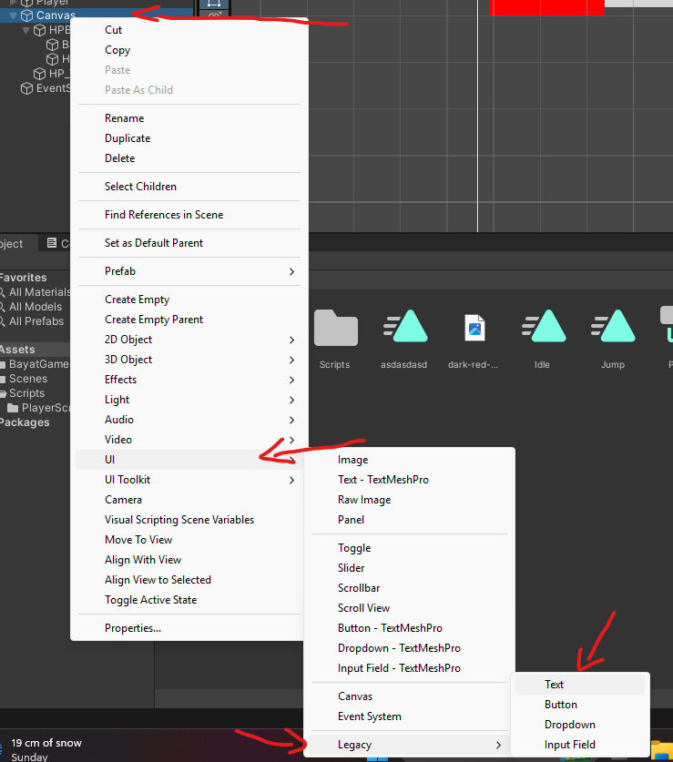

---

### Крок 2. Перемістити текст поруч з HP баром

Перемістіть створений Text одразу справа від HPBAR.

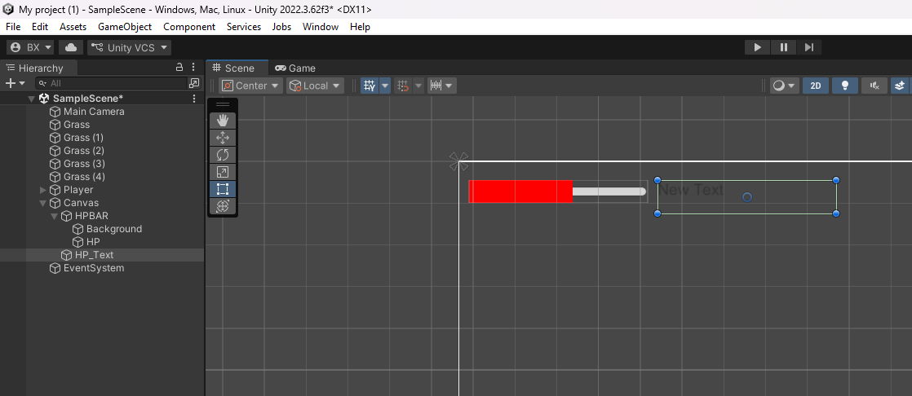

---

### Крок 3. Змінити колір тексту

В Inspector знайдіть поле Color та змініть його на білий.

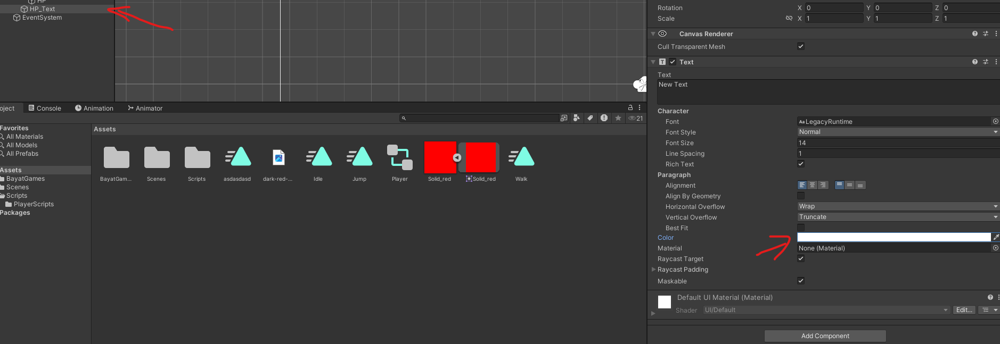

---

### Крок 4. Встановити початковий текст

В полі Text встановіть початкове значення:

```

100%

```

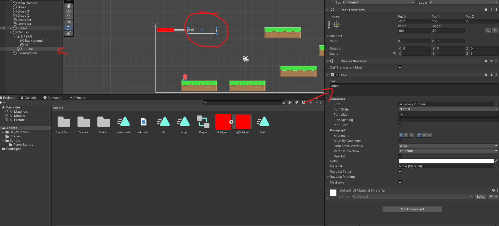

---

### Перевірка

Текст стоїть справа від HP бару  
Колір тексту білий  
Текст показує 100%

---
## Частина 8. Підключення HPBAR і HP Text до PlayerHealth

Тепер ми з’єднаємо UI елементи з нашим скриптом PlayerHealth, щоб здоров’я відображалось автоматично.

---

### Крок 1. Обрати Player в Hierarchy

У Hierarchy оберіть:

```

Player

```


---

### Крок 2. Знайти компонент PlayerHealth

У Inspector знайдіть компонент:

```

Player Health (Script)

```

У ньому є секція:

```

UI

```

Там будуть поля:

```

Health Slider
Health Text

```

---

### Крок 3. Підключити HPBAR

Перетягніть з Hierarchy об’єкт:

```

HPBAR

```

у поле:

```

Health Slider

```

---

### Крок 4. Підключити HP Text

Перетягніть з Hierarchy об’єкт:

```

HP_Text

```

у поле:

```

Health Text

```

---

### Як це повинно виглядати

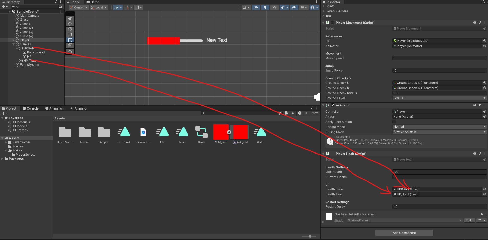

---

### Перевірка

Health Slider містить HPBAR  
Health Text містить HP_Text  

---
## Частина 9. Створення папки StaticEnemy та скрипта Spike

Тепер зробимо перший об’єкт який наносить урон гравцю.

Це буде Spike, статична пастка яка знімає HP при контакті.

---

### Крок 1. Створити папку StaticEnemy

У Project перейдіть у:

```

Assets → Scripts

```

Створіть нову папку:

```

StaticEnemy

```

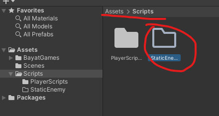

---

### Крок 2. Створити скрипт Spike

Відкрийте папку:

```

Assets → Scripts → StaticEnemy

```

Створіть новий C# Script та назвіть його:

```

Spike

```

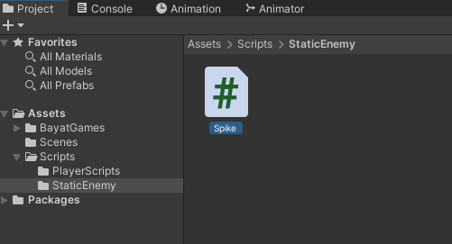

---

### Крок 3. Відкрийте Spike та вставте код

Відкрийте файл:

```

Spike.cs

````

Повністю замініть його вміст на цей код.

---

```csharp
using UnityEngine; // Базові класи Unity

public class Spike : MonoBehaviour // Скрипт пастки шип
{
    public int damage = 25; // Скільки урону наносить шип
    public bool destroyAfterHit = false; // Чи знищувати шип після контакту

    private void OnTriggerEnter2D(Collider2D other) // Коли хтось заходить у тригер
    {
        PlayerHealth health = other.GetComponent<PlayerHealth>(); // Шукаємо PlayerHealth на об’єкті що торкнувся

        if (health != null) // Якщо це гравець або об’єкт з PlayerHealth
        {
            health.TakeDamage(damage); // Наносимо урон гравцю

            if (destroyAfterHit) // Якщо увімкнено знищення після контакту
            {
                Destroy(gameObject); // Видаляємо сам об’єкт шипа
            }
        }
    }
}
````

---

## Частина 10. Додавання Spike на сцену та тест урону

Тепер додамо шипи на сцену і перевіримо чи вони знімають здоров’я у Player.

---

### Крок 1. Додати Spike на сцену

Додайте об’єкт шипів на сцену та назвіть його:

```

Spikes

```

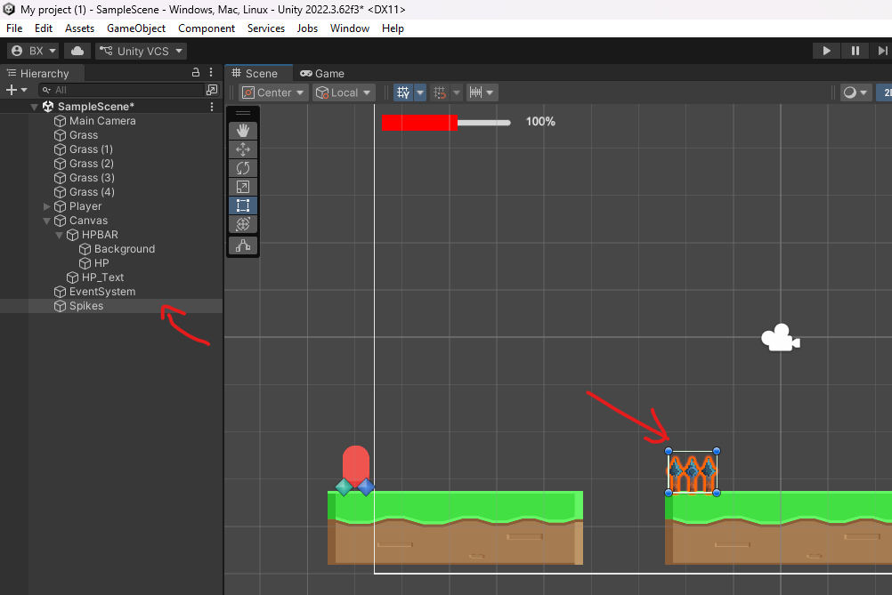

---

### Крок 2. Додати Collider2D

Додайте на Spikes будь-який Collider2D.  
У прикладі використовується:

```

BoxCollider2D

```

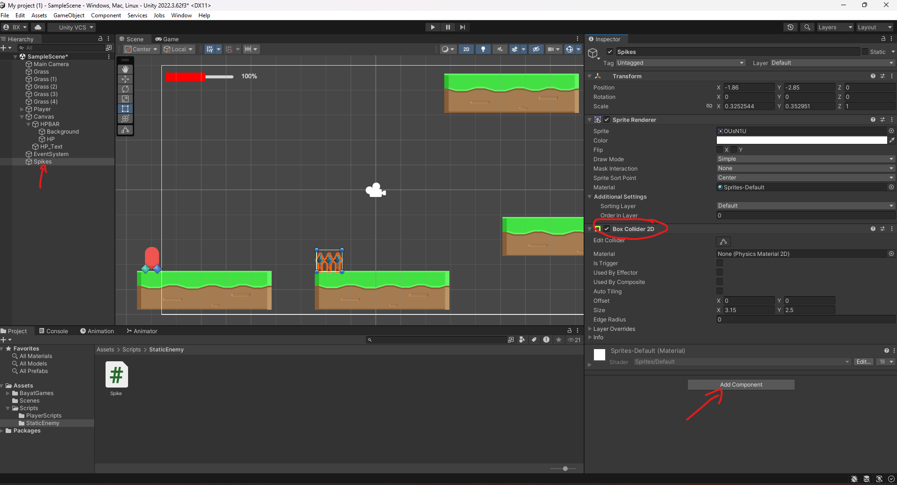

---

### Крок 3. Увімкнути Is Trigger

У Collider поставте галочку:

```

Is Trigger

```

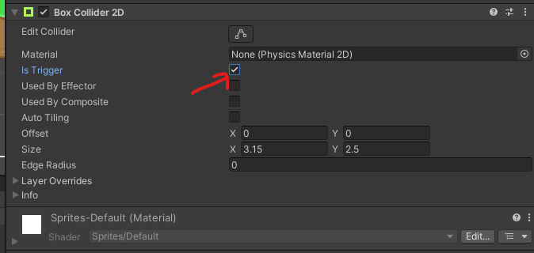

---

### Крок 4. Додати скрипт Spike

Перетягніть скрипт:

```

Spike.cs

```

на об’єкт Spikes.

---

### Крок 5. Налаштувати урон

В Inspector змініть значення:

```

Damage

```

за бажанням.

---

### Приклад

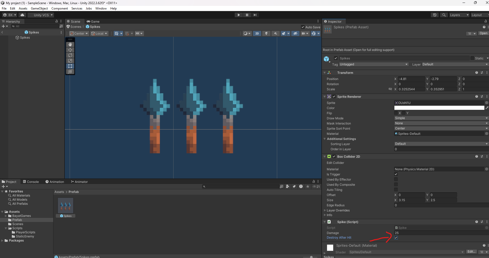

---

### Крок 6. Тест

Запустіть гру.

Зайдіть Player на Spikes.

Player повинен втрачати здоров’я.  
HP Bar повинен зменшуватись.  
HP Text повинен змінюватись.  

---

## Частина 11. Створення Prefab та підготовка до Fireball Spawner

Тепер ми підготуємо Prefab.  
Prefab потрібен щоб спавнити об’єкти під час гри, наприклад Fireball або ворогів.

---

### Що таке Prefab

Prefab це збережений шаблон GameObject.

Простими словами:
Це копія об’єкта яку можна створювати багато разів.

Наприклад:
Fireball створюється багато разів  
Ворог створюється багато разів  
Пастки можуть створюватися багато разів  

Замість створення вручну кожного разу ми використовуємо Prefab.

---

### Крок 1. Створити папку Prefab

У Project створіть папку:

```

Assets → Prefab

```

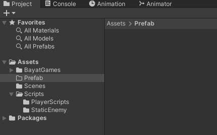

---

### Крок 2. Створити Prefab зі Spikes

Перетягніть об’єкт:

```

Spikes

```

з Hierarchy у папку:

```

Assets → Prefab

```

---

### Приклад

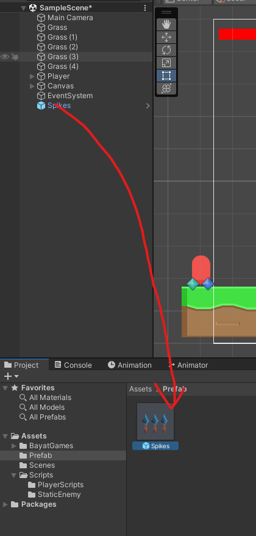

---

### Крок 3. Відкрити Prefab

Двічі натисніть на Prefab файл.

---

### Крок 4. Увімкнути Destroy After Hit

У Inspector знайдіть скрипт:

```

Spike

```

Увімкніть:

```

Destroy After Hit

```

---

### Приклад


---
Ааа, все, тепер зрозумів 🙂
Тобто **Fireball prefab = той самий Spike prefab**, просто ми його будемо спавнити і давати рух.

Тоді робимо **один тільки FireballSpawner**, без окремого Fireball скрипта.

---

## Частина 12. Створення FireballSpawner

Тепер зробимо спавнер який буде створювати "fireball".  
У нашому випадку fireball це той самий Spike prefab, тільки рухомий.

---

### Крок 1. Створити скрипт FireballSpawner

Перейдіть у папку:

Assets → Scripts → StaticEnemy

Створіть новий C# Script:

FireballSpawner

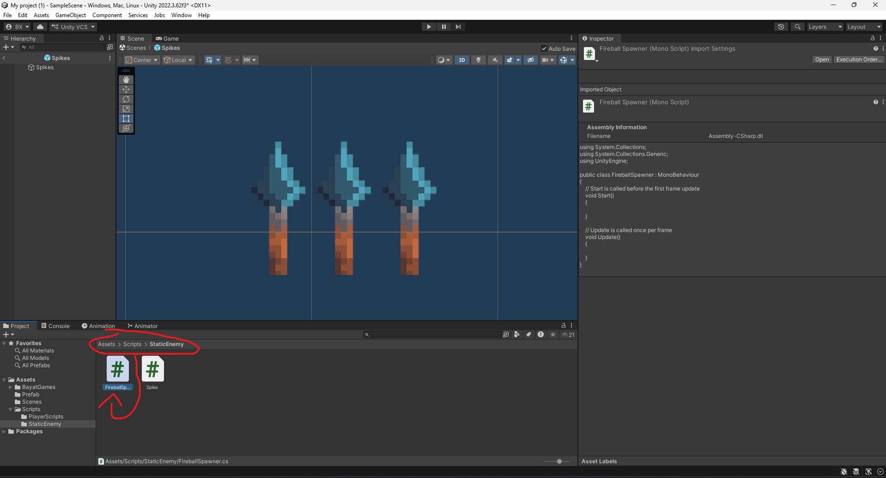

---

### Крок 2. Відкрити файл та вставити код


```csharp
using UnityEngine; // Підключаємо базові класи Unity

public class FireballSpawner : MonoBehaviour // Скрипт спавнера рухомих Spike (fireball)
{
    public GameObject fireballPrefab; // Префаб Spike який буде використовуватись як fireball
    public Transform firePoint; // Точка звідки буде з’являтись fireball
    public float spawnInterval = 2f; // Інтервал між спавнами
    public float fireballSpeed = 8f; // Швидкість польоту fireball

    void Start() // Метод викликається автоматично при старті сцени
    {
        InvokeRepeating("SpawnFireball", 1f, spawnInterval); // Викликає SpawnFireball кожні spawnInterval секунд
    }

    void SpawnFireball() // Метод який створює fireball
    {
        if (fireballPrefab == null) return; // Якщо prefab не заданий, нічого не робимо

        Transform spawnPoint = firePoint != null ? firePoint : transform; // Якщо firePoint заданий використовуємо його, інакше позицію об’єкта

        GameObject fb = Instantiate(fireballPrefab, spawnPoint.position, spawnPoint.rotation); // Створюємо копію prefab в точці спавну

        Rigidbody2D rb = fb.GetComponent<Rigidbody2D>(); // Пробуємо знайти Rigidbody2D на створеному об’єкті

        if (rb == null) // Якщо Rigidbody2D не знайдений
        {
            rb = fb.AddComponent<Rigidbody2D>(); // Додаємо Rigidbody2D через код
            rb.gravityScale = 0f; // Вимикаємо гравітацію щоб fireball не падав вниз
            rb.collisionDetectionMode = CollisionDetectionMode2D.Continuous; // Краща обробка швидких зіткнень
        }

        rb.velocity = spawnPoint.right * fireballSpeed; // Даємо швидкість вперед відносно напрямку спавну
    }
}
```
---

## Частина 13. Додавання FireballSpawner на сцену і налаштування FirePoint

Тепер ми додамо спавнер на сцену, створимо точку пострілу FirePoint і підключимо все в Inspector.

---

### Крок 1. Додати об’єкт спавнера на сцену

Додайте на сцену новий об’єкт, який буде спавнером.

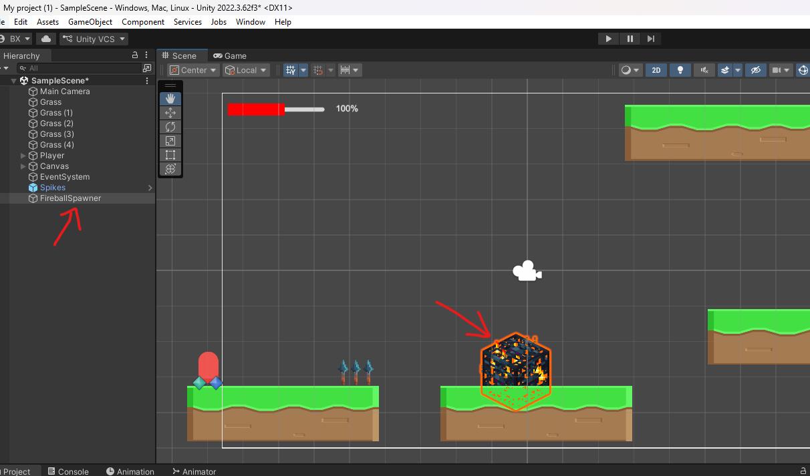

Назву можна зробити такою:

```

FireballSpawner

```

---

### Крок 2. Створити FirePoint як дочірній об’єкт

Натисніть правою кнопкою по об’єкту спавнера в Hierarchy і створіть дочірній об’єкт:

```

Create Empty

```

Назвіть його:

```

FirePoint

```

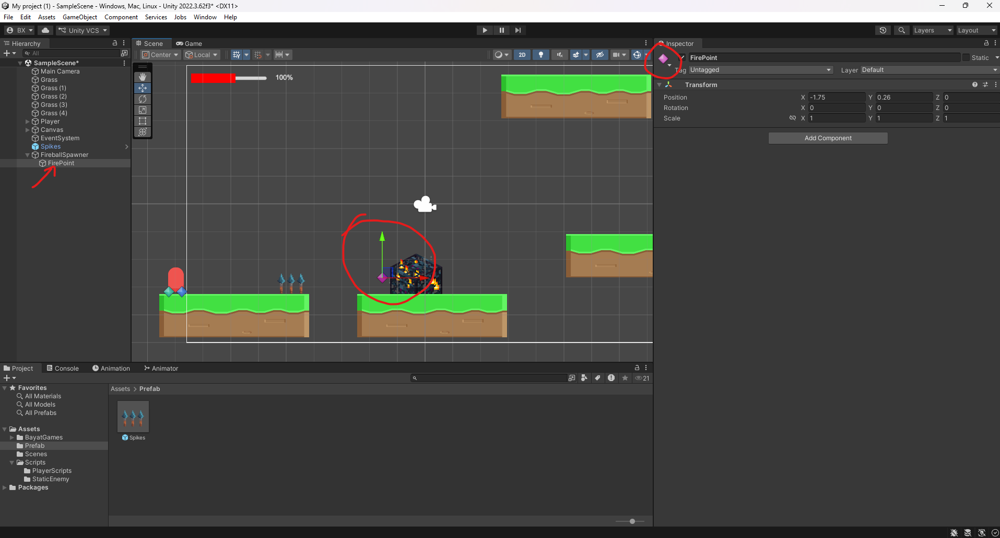

Дайте йому позначку біля Tag, щоб його було легко знаходити в Hierarchy.

Після цього трохи посуньте FirePoint так, щоб він був поза межами об’єкту FireballSpawner.  
Це потрібно, щоб fireball з’являвся перед спавнером, а не всередині нього.

---

### Крок 3. Перевірити структуру в Hierarchy

У вас повинно бути так:

```

FireballSpawner
└ FirePoint

```


---

### Крок 4. Додати скрипт FireballSpawner на об’єкт

Виберіть об’єкт:

```

FireballSpawner

```

Перетягніть на нього скрипт:

```

FireballSpawner.cs

```

або натисніть Add Component і додайте його через пошук.

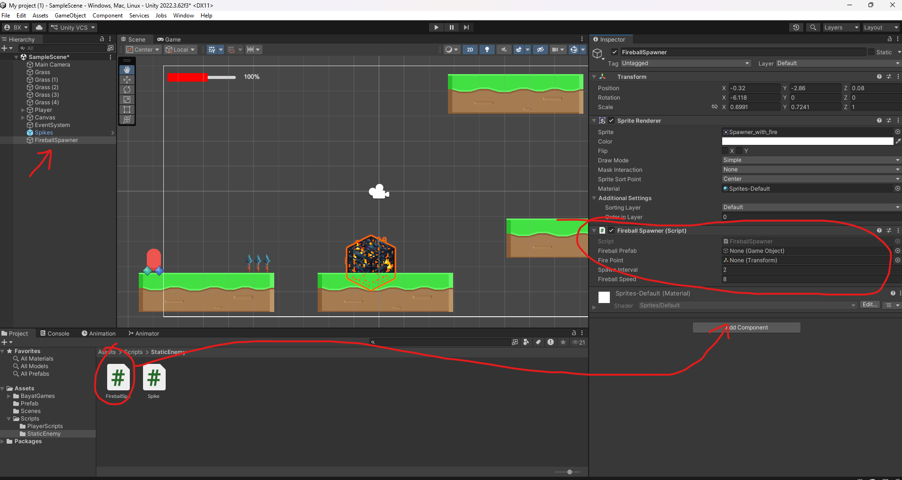

---

### Крок 5. Заповнити поля в Inspector

У компоненті FireballSpawner заповніть:

Fireball Prefab  
перетягніть сюди ваш Spike Prefab з папки Prefab

Fire Point  
перетягніть сюди об’єкт FirePoint з Hierarchy

Spawn Interval  
як часто спавниться fireball

Fireball Speed  
як швидко він летить

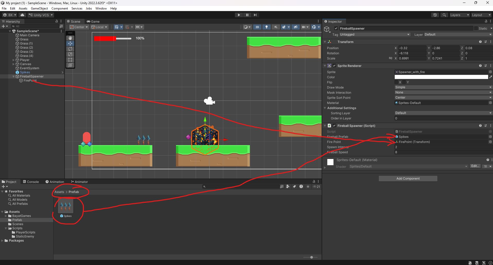

---

## Частина 14. Fireball тепер летить у сторону гравця

У цьому кроці ми змінюємо логіку FireballSpawner.

Раніше fireball летів вперед відносно напрямку спавнера.  
Тепер fireball буде летіти прямо у сторону Player.

---

### Що змінилось у логіці

Було:

Fireball летів по transform.right  
Тобто напрямок залежав тільки від повороту спавнера  

Стало:

Fireball летить у сторону Player  
Spawner знаходить Player через Tag  
Spawner рахує напрямок до Player  
Spawner дає fireball швидкість у цьому напрямку  

---

### Навіщо це потрібно

Тепер ворог виглядає "розумнішим"  
Fireball завжди летить у гравця  
Геймплей стає складнішим  

---

### Важливо

Player обов’язково має Tag:

```

Player

```

Інакше fireball не буде знати куди летіти.

---

### Оновлений код FireballSpawner

Замініть код у файлі:

```

FireballSpawner.cs

````

на цей:

```csharp
using UnityEngine; // Базові класи Unity

public class FireballSpawner : MonoBehaviour // Спавнер fireball який стріляє в Player
{
    public GameObject fireballPrefab; // Префаб Spike який використовується як fireball
    public Transform firePoint; // Точка спавну
    public float spawnInterval = 2f; // Інтервал спавну
    public float fireballSpeed = 8f; // Швидкість польоту

    private Transform player; // Посилання на Player

    void Start() // Викликається при старті сцени
    {
        GameObject playerObj = GameObject.FindGameObjectWithTag("Player"); // Шукаємо Player по тегу

        if (playerObj != null) // Якщо знайшли Player
            player = playerObj.transform; // Зберігаємо Transform Player

        InvokeRepeating("SpawnFireball", 1f, spawnInterval); // Запускаємо спавн fireball
    }

    void SpawnFireball() // Метод створення fireball
    {
        if (fireballPrefab == null) return; // Якщо prefab не заданий
        if (player == null) return; // Якщо Player не знайдений

        Transform spawnPoint = firePoint != null ? firePoint : transform; // Якщо нема FirePoint використовуємо сам об’єкт

        GameObject fb = Instantiate(fireballPrefab, spawnPoint.position, spawnPoint.rotation); // Створюємо fireball

        Rigidbody2D rb = fb.GetComponent<Rigidbody2D>(); // Шукаємо Rigidbody

        if (rb == null) // Якщо Rigidbody нема
        {
            rb = fb.AddComponent<Rigidbody2D>(); // Додаємо Rigidbody
            rb.gravityScale = 0f; // Вимикаємо гравітацію
            rb.collisionDetectionMode = CollisionDetectionMode2D.Continuous; // Краща точність зіткнень
        }

        Vector2 direction = (player.position - spawnPoint.position).normalized; // Рахуємо напрямок до Player

        rb.velocity = direction * fireballSpeed; // Даємо швидкість у сторону Player
    }
}
````

---

### Перевірка

Запустіть сцену.

Fireball повинен:

- спавнитись
- летіти у сторону Player
- наносити урон при контакті
- зникати після удару

### Домашнє завдання до Lesson 5–6

Зробіть анімацію отримання урону для Player. Найпростіший варіант це моргання: коли Player отримує damage, спрайт швидко перемикається між нормальним і прозорим кілька разів, потім повертається назад. Це має запускатись з коду в момент TakeDamage, щоб ефект був завжди однаковий.

Додайте анімації всім об’єктам на рівні. Player, spikes, fireball, spawner або його декоративна частина, фон або декор, якщо є. Для spikes можна зробити легке “пульсування” масштабу або блимання, для fireball можна зробити обертання або glow.

Розробіть ще 2 статичних ворога. Ідеї такі.

Перший ворог це AcidPool: калюжа кислоти або лазерна підлога. Працює як тригер, але наносить урон не один раз, а кожні 0.5 секунди, поки Player стоїть всередині. Це навчить вас робити damage over time.

Другий ворог це CrusherTrap: стеля або плита яка періодично “падає” вниз і повертається назад. Вона статична по місцю, але рухається по таймеру. Якщо Player торкнувся її під час руху або внизу, отримує великий урон. Це навчить вас робити циклічну анімацію пастки і синхронізацію урону.

Критерії перевірки. Ефект урону на Player має бути помітний і повторюваний. У кожного об’єкта має бути хоча б одна проста анімація. Два нових вороги повинні працювати без багів: перший з періодичним уроном, другий з циклом руху і уроном при контакті.
