# Unity 2D

## Lesson 7–8: Battle System, Enemy and Boss Setup

---

## Мета уроку

У цьому уроці ми додаємо у гру механіку бою. У попередніх кроках Player вже вміє рухатись, стрибати, має HP та отримує урон від пасток і fireball. Тепер Player почне відповідати ударом.

Ми зробимо так, щоб атака була прив’язана до анімації. Це важливо, бо тоді удар відбувається не “коли натиснув кнопку”, а в правильний момент руху меча. Саме так працює більшість ігор.

---

## Що ми зробимо в Lesson 7–8

Battle System
Player має Attack анімацію
Кнопка атаки запускає анімацію
На кадрі анімації викликається функція удару
Удар перевіряє ворогів в радіусі та наносить урон

Enemy
Створюємо ворога з HP
Ворог отримує урон від удару гравця
Готуємо основу для поведінки ворога

Boss
Створюємо боса як “посилений ворог”
Готуємо основу для спеціальних атак та фаз

---

## Частина 1. Створення Attack Animation Clip

Спочатку потрібно створити кліп атаки для Player.

Виберіть об’єкт Player у Hierarchy, потім відкрийте вікно Animation і натисніть на випадаючий список кліпів. Оберіть Create New Clip, як показано на прикладі.

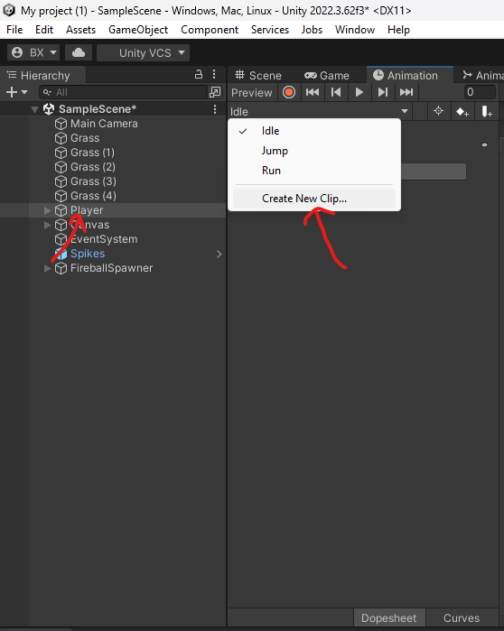

Далі збережіть кліп з назвою Attack у папку Animations вашого персонажа. На прикладі видно, що в пакеті вже є готові кліпи Attack1, Attack2, Attack3. Якщо у вас є готовий Attack, можна використати його, але для навчання ми створюємо свій окремий кліп Attack, щоб потім легко додати Animation Event.

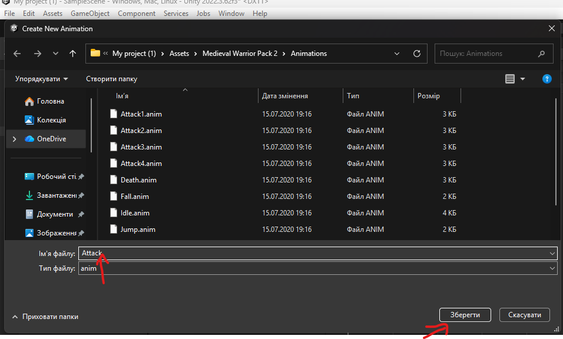

---

## Частина 2. Додавання параметра атаки в Animator

Тепер потрібно створити параметр, який буде запускати анімацію атаки з коду.

Відкрийте вікно Animator, перейдіть у вкладку Parameters і натисніть плюс. Додайте Trigger і назвіть його IsAttack.

Це саме той тригер, який ми вже використали в коді PlayerAttack.

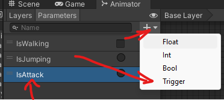

---

## Що важливо зрозуміти перед наступними кроками

Анімація атаки має запускатись через Trigger, але урон не повинен наноситись одразу при натисканні кнопки. Урон має наноситись в той момент, коли зброя “попадає” в ціль. Саме тому ми викликаємо функцію удару через Animation Event, прив’язаний до конкретного кадру Attack анімації.

## Частина 3. Переходи в атаку в Animator

На цьому кроці ми налаштовуємо всі переходи, які ведуть у стан атаки `Attack1`, щоб атака запускалась миттєво по тригеру `IsAttack`, без очікування завершення поточної анімації.

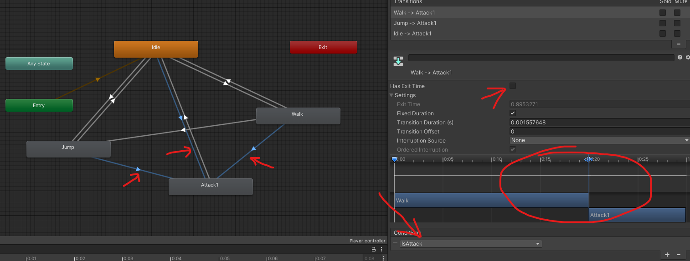

В Animator знайдіть усі стрілки, які входять у `Attack1`. У тебе на скріні це переходи `Idle → Attack1`, `Walk → Attack1`, `Jump → Attack1`. Клікни по кожному переходу окремо, щоб справа відкрився Inspector саме цього transition.

У кожному з цих переходів вимкни `Has Exit Time`. Це робить атаку “реактивною”, тобто вона стартує одразу після натискання кнопки, а не після того як Idle або Walk дійдуть до кінця циклу.

Потім у блоці `Conditions` додай умову `IsAttack`. Оскільки `IsAttack` це Trigger, Unity покаже його просто як умову без значення true або false. Після цього цей перехід буде спрацьовувати саме тоді, коли код викличе `animator.SetTrigger("IsAttack")`.

Швидка перевірка правильності. Якщо в Play Mode натиснути кнопку атаки під час Idle або Walk, персонаж має одразу перейти в `Attack1`. Якщо перехід запускається із затримкою або іноді не запускається, значить десь залишився увімкнений `Has Exit Time`, або умова в Conditions не `IsAttack`.

Коли це буде готово, кидай наступний скрін з вікна Animation для кліпа Attack1, і ми додамо Animation Event на кадр удару, щоб функція `AnimationEvent_AttackHit()` викликалась рівно в момент попадання.
## Частина 4. Вихід з Attack назад в Idle

Тепер налаштовуємо повернення з `Attack1` у `Idle`.

Спочатку у переході прапорець може бути вимкнений:

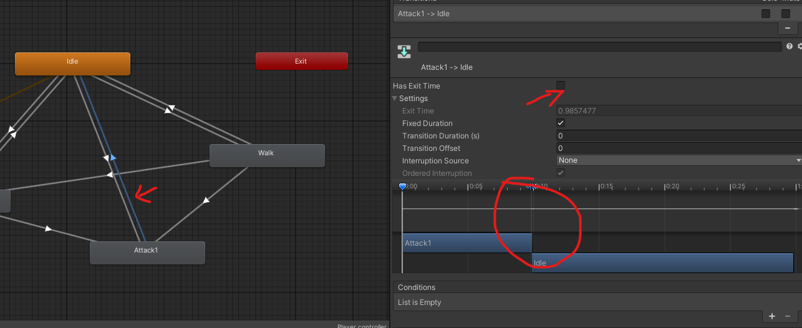

У вікні Animator виберіть стрілку `Attack1 → Idle`. Саме вона відповідає за завершення атаки.

У Inspector:

Увімкніть `Has Exit Time`:

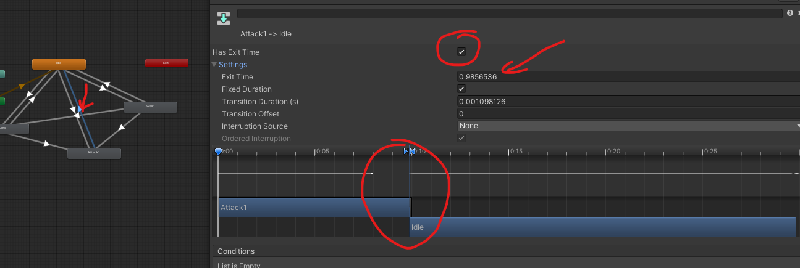

умови в `Conditions` залиште порожніми

Чому саме так.

Атака це коротка анімація, яка має відпрацювати повністю. Ми не використовуємо додатковий Bool для повернення, тому перехід назад повинен відбутися автоматично після завершення кліпу. Увімкнений `Has Exit Time` і порожній список умов повернуть персонажа в Idle після завершення Attack.

Після цього логіка така:

Idle → Attack1 по Trigger `IsAttack`
Attack1 → Idle автоматично після завершення анімації

## Частина 5. Скрипт PlayerAttack, EnemyHealth — детальний розбір

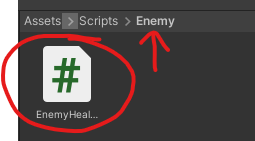

```
using UnityEngine;

public class EnemyHealth : MonoBehaviour
{
    [Header("Health Settings")]
    public int maxHealth = 100;   // Максимальне HP ворога

    private int currentHealth;    // Поточне HP
    private bool isDead = false;  // Захист від повторної смерті

    private void Awake()
    {
        // При створенні ворог отримує повне здоров'я
        currentHealth = maxHealth;
    }

    // Метод викликається з PlayerAttack
    public void TakeDamage(int damage)
    {
        // Якщо ворог вже мертвий — нічого не робимо
        if (isDead)
            return;

        // Віднімаємо урон
        currentHealth -= damage;

        // Перевірка на смерть
        if (currentHealth <= 0)
        {
            Die();
        }
    }

    private void Die()
    {
        isDead = true;

        // Поки що просто знищуємо об’єкт
        // Пізніше тут можна додати анімацію смерті,
        // ефекти, звук, випадіння лута тощо
        Destroy(gameObject);
    }
}
```

### Як це працює

PlayerAttack знаходить ворога через OverlapCircle
Викликає enemy.TakeDamage(damage)
HP зменшується
Якщо HP ≤ 0 → ворог знищується

---

### PlayerAttack.cs

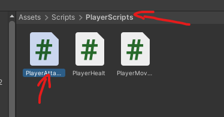
```csharp
using UnityEngine;

public class PlayerAttack : MonoBehaviour
{
    // ===== ПОСИЛАННЯ НА КОМПОНЕНТИ =====

    [Header("References")]
    public Animator animator;          // Animator персонажа, потрібен для запуску IsAttack
    public Transform attackPoint;      // Точка, в якій перевіряється попадання удару

    // ===== НАЛАШТУВАННЯ УДАРУ =====

    [Header("Attack Settings")]
    public float attackRadius = 0.45f; // Радіус удару
    public LayerMask enemyLayer;       // Layer ворогів, щоб не бити все підряд
    public int damage = 25;            // Кількість урону за один удар

    // ===== КУЛДАУН АТАКИ =====

    [Header("Timing")]
    public float attackCooldown = 0.35f; // Мінімальна пауза між атаками
    private float nextAttackTime = 0f;   // Час, коли можна атакувати знову

    private void Awake()
    {
        // Якщо Animator не підключений вручну — беремо з цього ж об’єкта
        if (animator == null)
            animator = GetComponent<Animator>();
    }

    private void Update()
    {
        // Якщо ще не настав час наступної атаки — виходимо
        if (Time.time < nextAttackTime)
            return;

        // Натискання кнопки атаки
        if (Input.GetMouseButtonDown(0) || Input.GetKeyDown(KeyCode.J))
        {
            // Встановлюємо наступний допустимий час атаки
            nextAttackTime = Time.time + attackCooldown;

            // Запускаємо тригер в Animator
            // Далі вже Animator переведе нас в Attack1
            if (animator != null)
                animator.SetTrigger("IsAttack");
        }
    }

    // ===== ЦЕЙ МЕТОД ВИКЛИКАЄТЬСЯ З ANIMATION EVENT =====
    // Додається в кліп Attack1 на кадрі удару

    public void AnimationEvent_AttackHit()
    {
        // Якщо attackPoint не заданий — нічого не робимо
        if (attackPoint == null)
            return;

        // Шукаємо всі колайдери ворогів в радіусі
        Collider2D[] hits = Physics2D.OverlapCircleAll(
            attackPoint.position, // Центр перевірки
            attackRadius,         // Радіус
            enemyLayer            // Тільки вороги
        );

        // Проходимо по всіх знайдених об'єктах
        for (int i = 0; i < hits.Length; i++)
        {
            // Пробуємо отримати EnemyHealth
            EnemyHealth enemy = hits[i].GetComponent<EnemyHealth>();

            // Якщо це ворог — наносимо урон
            if (enemy != null)
                enemy.TakeDamage(damage);
        }
    }

    // Малює радіус удару в Scene View для зручності налаштування
    private void OnDrawGizmosSelected()
    {
        if (attackPoint == null)
            return;

        Gizmos.DrawWireSphere(attackPoint.position, attackRadius);
    }
}
```

---

## Короткий логічний опис роботи

1. Гравець натискає кнопку атаки.
2. Код запускає `IsAttack` в Animator.
3. Animator переходить у стан `Attack1`.
4. На потрібному кадрі в анімації викликається `AnimationEvent_AttackHit()`.
5. Метод перевіряє ворогів у радіусі.
6. Кожному знайденому ворогу викликається `TakeDamage(damage)`.

---

## Чому це правильно з точки зору геймдизайну

Урон не наноситься в момент натискання кнопки.
Урон наноситься в момент попадання зброї.

Це дозволяє:

робити різні таймінги атак
робити важкі повільні удари
робити швидкі комбо
робити боса з іншими таймінгами

---

## Додавання нового Layer для ворога

Щоб мати можливість визначати ворогів у коді або логіці гри, створимо окремий Layer з назвою `Enemy`.

---

### Крок 1. Відкрити список Layer

Виділіть будь-який об’єкт у сцені.
У верхній частині Inspector відкрийте список **Layer** та натисніть:

Add Layer...

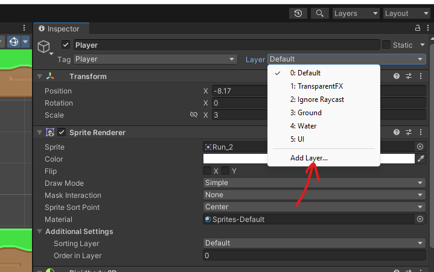

---

### Крок 2. Створити новий Layer

У вікні **Tags & Layers** введіть назву у вільне поле **User Layer**:

Enemy

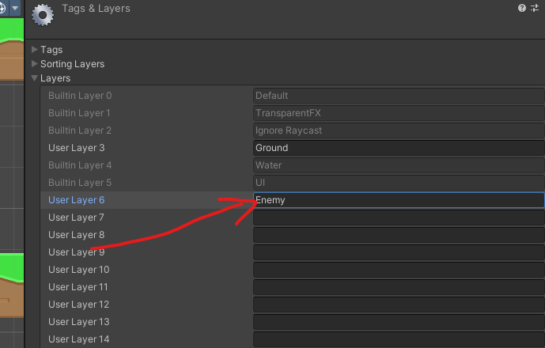

---
## Підключення Enemy Layer та PlayerAttack в Inspector

Після створення Layer потрібно правильно підключити все в Inspector, щоб атака реально працювала.

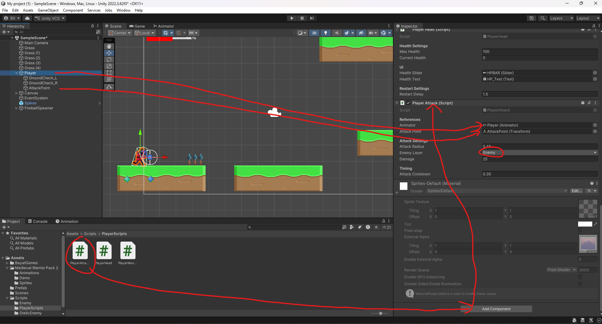

---

### Крок 1. Додати PlayerAttack на Player

У Hierarchy виберіть об’єкт **Player**.
В Inspector натисніть **Add Component** та додайте скрипт:

```
PlayerAttack
```

Після цього з’явиться блок Player Attack (Script).

---

### Крок 2. Підключити Animator

У полі **Animator** перетягніть компонент Animator з об’єкта Player.

Це потрібно для того, щоб код міг викликати:

```
animator.SetTrigger("IsAttack");
```

---

### Крок 3. Підключити AttackPoint

У Hierarchy у вас є дочірній об’єкт **AttackPoint**.

Перетягніть його в поле:

```
Attack Point
```

Саме з цієї точки буде перевірятись попадання удару.

---

### Крок 4. Вибрати Enemy Layer

У полі **Enemy Layer** відкрийте список та виберіть:

```
Enemy
```

Це дозволяє функції OverlapCircle перевіряти тільки ворогів.

---

### Перевірка

У вас повинно бути:

Animator підключений
AttackPoint підключений
Enemy Layer встановлений
Damage виставлений
Attack Cooldown виставлений

Наступний крок — додавання Animation Event у кліп Attack1, щоб викликати `AnimationEvent_AttackHit()` у момент удару.
## Додавання Animation Event на кадрі удару

Тепер потрібно зробити найважливіше — прив’язати реальний урон до конкретного кадру анімації.

---

### Крок 1. Знайти кадр попадання

Відкрийте кліп `Attack1` у вікні **Animation**.

Прокрутіть таймлайн і знайдіть момент, де меч або рука знаходяться в точці максимального удару. Саме на цьому кадрі має спрацювати урон.

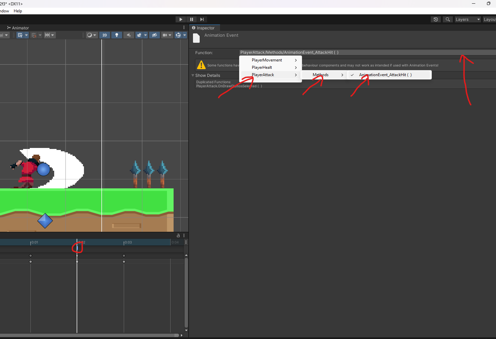

---

### Крок 2. Додати Animation Event

На таймлайні натисніть кнопку **Add Event** або клацніть правою кнопкою на потрібному кадрі.

З’явиться маркер події.


---

### Крок 3. Вибрати функцію

Клікніть по створеному маркеру події.

У Inspector у полі **Function** відкрийте список та виберіть:

PlayerAttack → Methods → AnimationEvent_AttackHit()

Саме ця функція з нашого скрипта виконається в момент попадання.

---

## Що тепер відбувається в грі

1. Натискається кнопка атаки
2. Animator переходить у `Attack1`
3. На кадрі удару спрацьовує Animation Event
4. Викликається `AnimationEvent_AttackHit()`
5. Перевіряються вороги в радіусі
6. Якщо ворог у зоні — він отримує урон

Тепер атака повністю синхронізована з анімацією, і система бою працює правильно.

# Ворог.

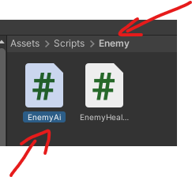
---

### EnemyAI.cs з коментарями

```csharp
using UnityEngine;

public class EnemyAI : MonoBehaviour
{
    // ===== ПОСИЛАННЯ =====

    [Header("References")]
    public Transform player; // Посилання на гравця

    // ===== РУХ =====

    [Header("Movement")]
    public float moveSpeed = 2f; // Швидкість руху ворога

    // ===== ПАТРУЛЬ =====

    [Header("Patrol")]
    public float patrolDistance = 3f; // Наскільки далеко від стартової точки ворог ходить

    // ===== ДЕТЕКЦІЯ =====

    [Header("Detection")]
    public float detectionRange = 5f; // Відстань, на якій ворог бачить гравця

    private Vector2 startPosition; // Початкова позиція ворога
    private bool movingRight = true; // Поточний напрямок патрулю
    private Rigidbody2D rb; // Rigidbody для руху через фізику

    private void Awake()
    {
        // Отримуємо Rigidbody
        rb = GetComponent<Rigidbody2D>();

        // Запам’ятовуємо стартову позицію
        startPosition = transform.position;

        // Якщо гравець не підключений вручну — шукаємо його по тегу
        if (player == null)
        {
            GameObject p = GameObject.FindGameObjectWithTag("Player");
            if (p != null)
                player = p.transform;
        }
    }

    private void FixedUpdate()
    {
        // Якщо гравця не знайдено — нічого не робимо
        if (player == null)
            return;

        // Обчислюємо відстань до гравця
        float distanceToPlayer = Vector2.Distance(transform.position, player.position);

        // Якщо гравець у зоні бачення — переслідуємо
        if (distanceToPlayer <= detectionRange)
        {
            ChasePlayer();
        }
        else
        {
            // Інакше — патрулюємо
            Patrol();
        }
    }

    private void Patrol()
    {
        // Ліва і права межі патрулю
        float leftLimit = startPosition.x - patrolDistance;
        float rightLimit = startPosition.x + patrolDistance;

        if (movingRight)
        {
            // Рухаємось вправо
            rb.velocity = new Vector2(moveSpeed, rb.velocity.y);

            // Якщо дійшли до правої межі — змінюємо напрямок
            if (transform.position.x >= rightLimit)
                movingRight = false;
        }
        else
        {
            // Рухаємось вліво
            rb.velocity = new Vector2(-moveSpeed, rb.velocity.y);

            // Якщо дійшли до лівої межі — змінюємо напрямок
            if (transform.position.x <= leftLimit)
                movingRight = true;
        }

        // Розвертаємо спрайт у сторону руху
        FlipSprite(rb.velocity.x);
    }

    private void ChasePlayer()
    {
        // Різниця по X між гравцем і ворогом
        float direction = player.position.x - transform.position.x;

        if (direction > 0)
        {
            // Гравець правіше — рух вправо
            rb.velocity = new Vector2(moveSpeed, rb.velocity.y);
        }
        else
        {
            // Гравець лівіше — рух вліво
            rb.velocity = new Vector2(-moveSpeed, rb.velocity.y);
        }

        // Розворот у сторону гравця
        FlipSprite(rb.velocity.x);
    }

    private void FlipSprite(float moveX)
    {
        // Якщо не рухається — нічого не робимо
        if (moveX == 0)
            return;

        Vector3 scale = transform.localScale;

        // Якщо рух вправо — робимо scale.x позитивним
        if (moveX > 0)
            scale.x = Mathf.Abs(scale.x);
        else
            // Якщо вліво — негативним
            scale.x = -Mathf.Abs(scale.x);

        transform.localScale = scale;
    }
}
```
Добре, ось повністю оформлений блок для уроку 7–8 з урахуванням твоїх нових скрінів.

---

# Крок. Налаштування ворога в сцені

Після створення скриптів `EnemyAI` та `EnemyHealth` потрібно правильно зібрати ворога в сцені.

---

## 1. Об’єкт ворога в Hierarchy

У сцені у вас з’явився ворог, наприклад:

```
HeavyBandit_1
```

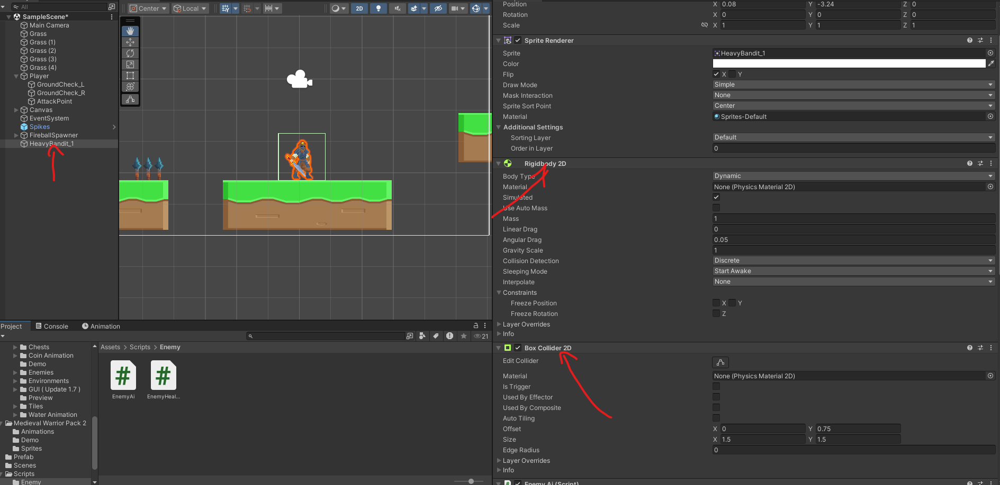

---

## 2. Додавання фізики

Виділіть ворога та переконайтесь, що в Inspector є:

✔ **Rigidbody2D**
✔ **BoxCollider2D**

У Rigidbody2D:

* Body Type → `Dynamic`
* Simulated → увімкнено
* Gravity Scale → 1
* Freeze Rotation по осі Z → увімкнути

У BoxCollider2D:

* Is Trigger → вимкнено
* Розмір колайдера повинен охоплювати тіло ворога

---

## 3. Додавання EnemyAI

На ворозі повинен бути компонент:

```
EnemyAI (Script)
```

У полі:

```
Player (Transform)
```

Перетягніть об’єкт Player з Hierarchy.

Це потрібно для того, щоб ворог знав, кого переслідувати.

---

## 4. Додавання EnemyHealth

Також на ворозі повинен бути компонент:

```
EnemyHealth (Script)
```

У ньому встановлюється:

```
Max Health
```

Це кількість HP ворога.

---

## Підсумковий вигляд Inspector

В Inspector ворога повинно бути:

✔ Sprite Renderer
✔ Rigidbody2D
✔ BoxCollider2D
✔ EnemyAI (Script)
✔ EnemyHealth (Script)

Як на прикладі:

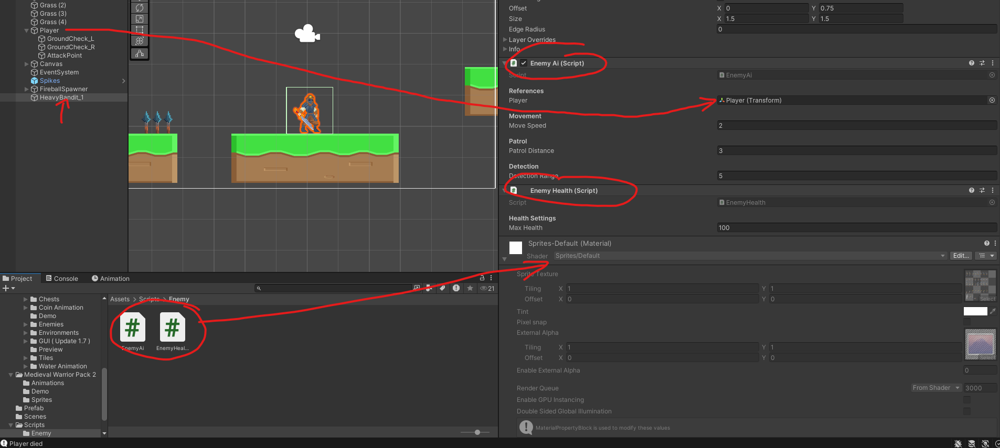

---

## Перевірка роботи

Після запуску гри ворог повинен:

рухатись вліво та вправо
не падати з платформи
бачити гравця на відстані Detection Range
починати переслідування

---

## Якщо ворог не рухається

Перевірте:

чи у Player є Tag `Player`
чи підключений Player в EnemyAI
чи увімкнений Simulated у Rigidbody2D
чи Detection Range не занадто малий

---

Після цього базова поведінка ворога готова.


# Завдання на самостійну роботу

- додайте анімацію ходьби та удару для ворога
- додайте функцію в код для атаки для ворога
- у ворога при анімації атаки викличте функцію яка буде бити користувача (за аналогією з тим як працює в головного героя)


# Домашня робота

- додайте боса, який має три різні механіки (анімації удару)
- та дві фази. 