# Unity 2D

## Lesson 8-9: Interact with Object, Chest UI and Rewards

---

## Мета уроку

У цьому уроці ми:

- налаштуємо систему взаємодії з об'єктами через клавішу `E`
- створимо окремий шар `Interactable`
- підготуємо скриню (Collider + Layer + Animator)
- зробимо UI скрині з трьома слотами предметів
- підключимо скрипти `IInteractable`, `PlayerInteractionSystem`, `Chest`, `ChestUI`, `ChestSlot`, `ChestItem`

---

## Що буде в результаті

Після уроку гравець зможе:

- підійти до скрині
- натиснути `E`
- запустити анімацію відкриття
- отримати меню з 3 випадковими нагородами
- натиснути на нагороду і застосувати її

---

## Частина 1. Створення шару `Interactable`

### Крок 1. Відкрити налаштування Layer

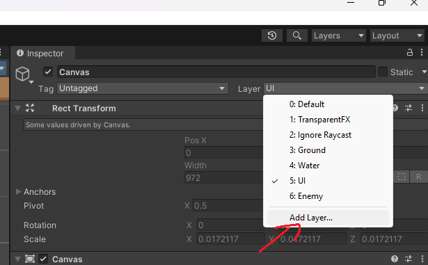

У `Inspector` зверху знайдіть поле `Layer`.

1. Натисніть випадаючий список `Layer`
2. Оберіть `Add Layer...`

### Крок 2. Додати новий шар

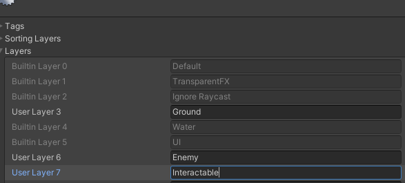

У будь-який вільний `User Layer` впишіть:

`Interactable`

Цей шар потрібен, щоб `Raycast` перевіряв тільки інтерактивні об'єкти.

---

## Частина 2. Підготовка об'єкта скрині

### Крок 1. Додати скриню у сцену

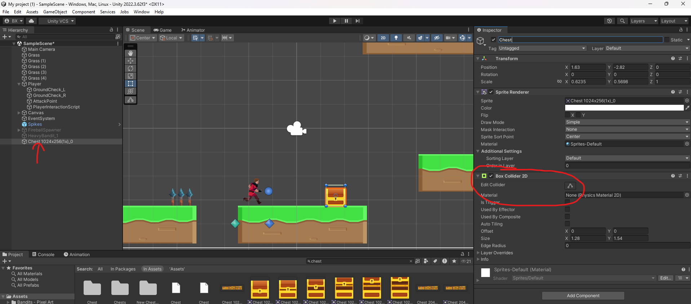

Перетягніть спрайт скрині з `Project` у `Hierarchy` або прямо в `Scene`.

Перейменуйте об'єкт у:

`Chest`

### Крок 2. Додати Collider

1. Виділіть `Chest`
2. Натисніть `Add Component`
3. Додайте `Box Collider 2D`

`Is Trigger` залишайте вимкненим (за вашим поточним підходом через `Raycast2D`).

### Крок 3. Встановити правильний Layer

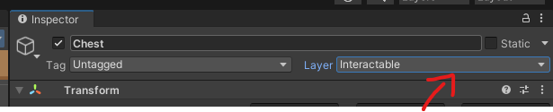

У `Inspector` встановіть для `Chest`:

`Layer = Interactable`

---

## Частина 3. Анімації скрині

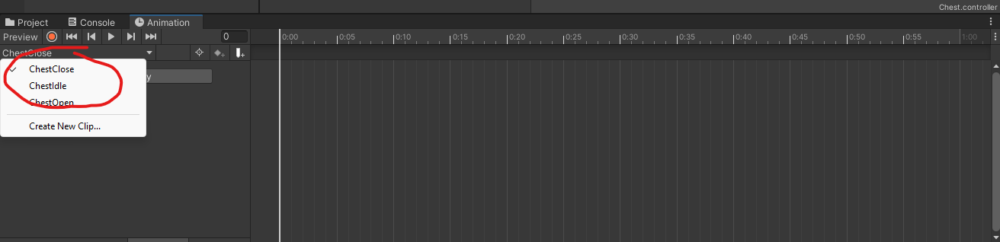

Створіть 3 кліпи:

- `ChestClose`
- `ChestOpen`
- `ChestIdle`

Рекомендована логіка:

- `ChestIdle` або `ChestClose` як стартовий стан
- при взаємодії перехід у `ChestOpen`
- після завершення відкриття перехід у кінцевий стан відкритої скрині

---

## Частина 4. Створення UI скрині

### Крок 1. Створити Canvas

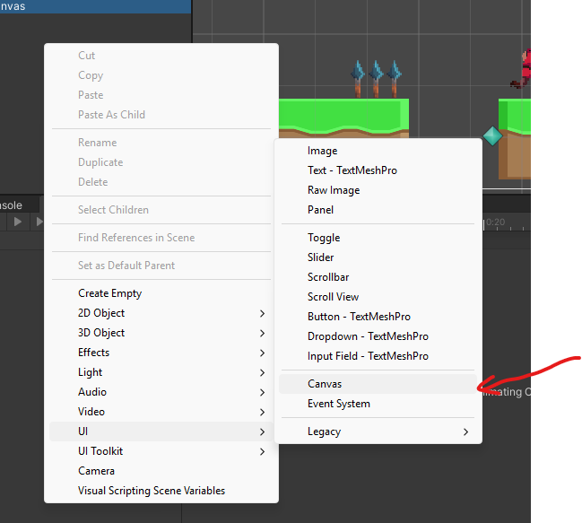

У `Hierarchy`:

`Right Click -> UI -> Canvas`

### Крок 2. Створити корінь UI

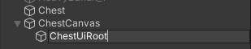

Всередині Canvas створіть порожній об'єкт:

`ChestUiRoot`

### Крок 3. Створити Panel

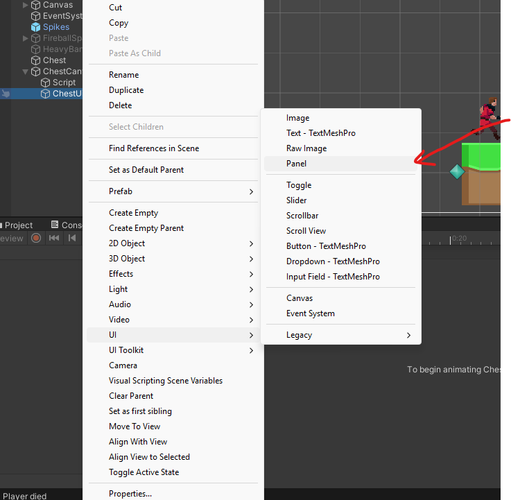

Після створення Panel перевірте її розташування на Canvas:

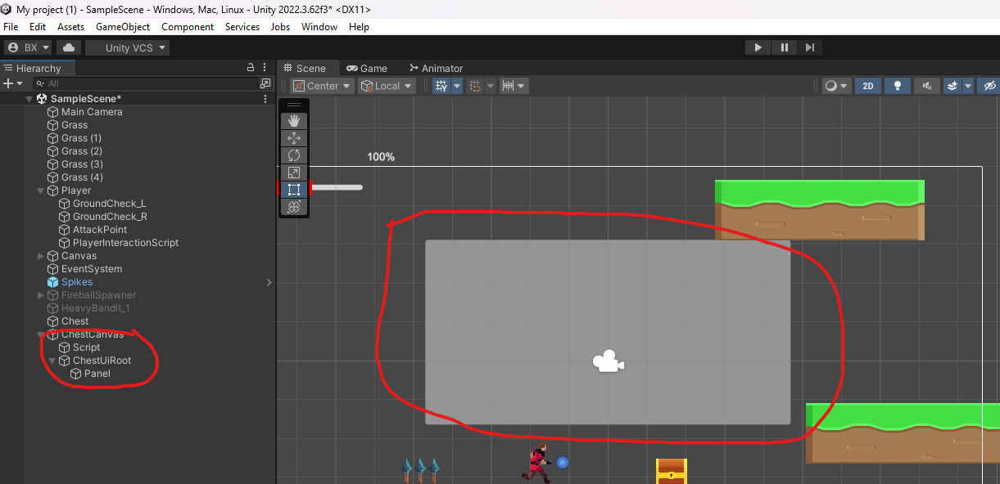

Всередині `ChestUiRoot`:

`Right Click -> UI -> Panel`

### Крок 4. Створити 3 слоти предметів

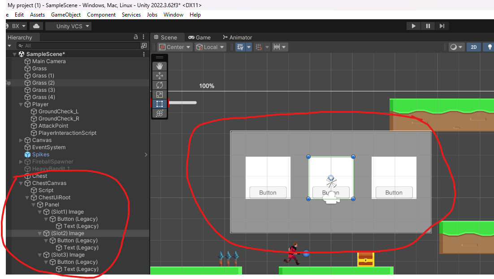

У `Panel` створіть 3 елементи `Image`:

- `Slot1 Image`
- `Slot2 Image`
- `Slot3 Image`

У кожен слот додайте:

- `Button (Legacy)`
- `Text (Legacy)`

---

## Частина 5. Скрипти уроку

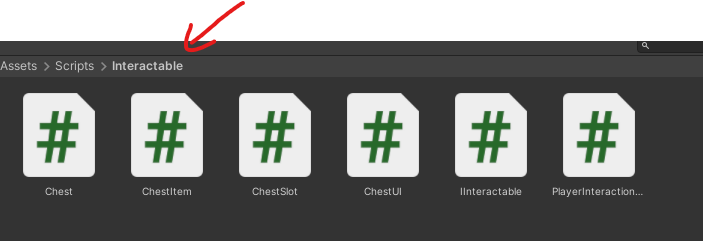

У папці `Assets/Scripts/Interactable` мають бути:

- `IInteractable.cs`
- `PlayerInteractionSystem.cs`
- `Chest.cs`
- `ChestUI.cs`
- `ChestSlot.cs`
- `ChestItem.cs`

Код використовуємо ваш поточний (оновлений у проєкті).

---

## Частина 5.1. Код скриптів для копіювання

### IInteractable.cs

```csharp
using UnityEngine;

public interface IInteractable
{
    void Interact(GameObject player);
}
```

### PlayerInteractionSystem.cs

```csharp
using UnityEngine; // підключаємо бібліотеку Unity

public class PlayerInteractionSystem : MonoBehaviour // створюємо компонент системи взаємодії
{
    public float interactionDistance = 1.2f; // дистанція перевірки взаємодії
    public LayerMask interactionLayer; // шар об'єктів з якими можна взаємодіяти

    private IInteractable currentTarget; // змінна для збереження знайденого об'єкта

    void Update() // метод викликається кожен кадр
    {
        DetectInteractable(); // перевіряємо чи є перед гравцем інтерактивний об'єкт

        if (currentTarget != null && Input.GetKeyDown(KeyCode.E)) // якщо об'єкт знайдений і натиснута клавіша E
        {
            currentTarget.Interact(gameObject); // викликаємо взаємодію
        }
    }

    void DetectInteractable() // метод пошуку об'єктів
    {
        RaycastHit2D hit = Physics2D.Raycast( // створюємо промінь
            transform.position, // початок променя
            transform.right, // напрямок променя
            interactionDistance, // максимальна дистанція
            interactionLayer // перевіряємо тільки потрібний шар
        );

        if (hit.collider == null) // якщо об'єкт не знайдений
        {
            currentTarget = null; // очищаємо змінну
            return; // завершуємо метод
        }

        currentTarget = hit.collider.GetComponent<IInteractable>(); // отримуємо компонент взаємодії
    }

    void OnDrawGizmosSelected() // малюємо допоміжну лінію у сцені
    {
        Gizmos.color = Color.yellow; // встановлюємо колір

        Gizmos.DrawLine( // малюємо лінію перевірки
            transform.position, // початок
            transform.position + transform.right * interactionDistance // кінець
        );
    }
}
```

### Chest.cs

```csharp
using UnityEngine; // підключаємо бібліотеку Unity

public class Chest : MonoBehaviour, IInteractable // клас скрині який підтримує взаємодію
{
    public Animator animator; // посилання на Animator скрині
    public ChestUI chestUI; // посилання на UI скрині

    private bool opened; // змінна яка перевіряє чи була скриня вже відкрита

    public void Interact(GameObject player) // метод який викликається системою взаємодії
    {
        if (opened) return; // якщо скриня вже відкрита нічого не робимо

        opened = true; // позначаємо що скриня відкрита

        if (animator != null) // перевіряємо чи існує Animator
            animator.SetTrigger("Open"); // запускаємо анімацію відкриття

        Invoke(nameof(OpenUI), 0.6f); // відкриваємо UI через невелику затримку
    }

    void OpenUI() // метод відкриття меню скрині
    {
        chestUI.Show(); // показуємо UI
        chestUI.GenerateItems(); // генеруємо випадкові предмети
    }
}
```

### ChestItem.cs

```csharp
using UnityEngine; // підключаємо бібліотеку Unity

public enum ChestItemType // перелік можливих типів предметів
{
    HP, // предмет відновлення здоров'я
    Power, // предмет збільшення сили
    Coins // предмет який дає монети
}

[System.Serializable] // дозволяє Unity серіалізувати цей клас
public class ChestItem // клас предмета скрині
{
    public ChestItemType type; // тип предмета
    public int value; // значення бонусу

    public ChestItem(ChestItemType type, int value) // конструктор класу
    {
        this.type = type; // записуємо тип предмета
        this.value = value; // записуємо значення бонусу
    }
}
```

### ChestUI.cs

```csharp
using UnityEngine; // підключаємо Unity
using System.Collections.Generic; // підключаємо роботу зі списками

public class ChestUI : MonoBehaviour // створюємо клас керування UI скрині
{
    public GameObject uiRoot; // кореневий об'єкт меню скрині
    public ChestSlot[] slots; // масив слотів предметів

    private List<ChestItem> generatedItems = new List<ChestItem>(); // список згенерованих предметів

    void Start()
    {
        Hide();
    }

    public void Show() // метод показу UI
    {
        uiRoot.SetActive(true); // активуємо меню
    }

    public void Hide() // метод приховування UI
    {
        uiRoot.SetActive(false); // вимикаємо меню
    }

    public void GenerateItems() // генерація предметів у скрині
    {
        generatedItems.Clear(); // очищаємо попередні предмети

        for (int i = 0; i < 3; i++) // створюємо три предмети
        {
            ChestItemType type = (ChestItemType)Random.Range(0, 3); // випадково вибираємо тип предмета

            int value = 0; // значення бонусу

            if (type == ChestItemType.HP) // якщо предмет HP
                value = Random.Range(10, 35); // випадкове відновлення здоров'я

            if (type == ChestItemType.Power) // якщо предмет Power
                value = Random.Range(1, 8); // випадковий бонус сили

            if (type == ChestItemType.Coins) // якщо предмет Coins
                value = Random.Range(10, 80); // випадкова кількість монет

            ChestItem item = new ChestItem(type, value); // створюємо предмет

            generatedItems.Add(item); // додаємо предмет у список

            slots[i].SetItem(item, this); // передаємо предмет у відповідний слот UI
        }
    }

    public void ApplyItem(ChestItem item) // метод застосування предмета
    {
        GameObject player = GameObject.FindGameObjectWithTag("Player"); // знаходимо гравця у сцені

        PlayerHealt health = player.GetComponent<PlayerHealt>(); // отримуємо компонент здоров'я
        PlayerAttack attack = player.GetComponent<PlayerAttack>(); // отримуємо компонент здоров'я

        if (item.type == ChestItemType.HP) // якщо предмет HP
            health.Heal(item.value); // додаємо здоров'я

        if (item.type == ChestItemType.Power) // якщо предмет Power
            attack.damage += item.value; // повідомлення у консоль

        if (item.type == ChestItemType.Coins) // якщо предмет Coins
            Debug.Log("Coins +" + item.value); // повідомлення у консоль

        Hide(); // закриваємо меню після вибору предмета
    }
}
```

### ChestSlot.cs

```csharp
using UnityEngine; // підключаємо Unity
using UnityEngine.UI; // підключаємо систему UI

public class ChestSlot : MonoBehaviour // клас одного слота предмета
{
    public Text label; // текст який показує назву предмета
    public Button button; // кнопка вибору предмета

    private ChestItem item; // предмет який знаходиться у слоті
    private ChestUI chestUI; // посилання на UI скрині

    public void SetItem(ChestItem item, ChestUI chestUI) // метод налаштування слота
    {
        this.item = item; // зберігаємо предмет
        this.chestUI = chestUI; // зберігаємо посилання на UI

        label.text = item.type + " +" + item.value; // відображаємо текст предмета

        button.onClick.RemoveAllListeners(); // очищаємо старі події кнопки
        button.onClick.AddListener(OnClick); // додаємо нову подію натискання
    }

    void OnClick() // метод який викликається при натисканні кнопки
    {
        chestUI.ApplyItem(item); // передаємо предмет у систему UI
    }
}
```

---

## Частина 6. Підключення скриптів у Inspector

### Крок 1. PlayerInteractionSystem

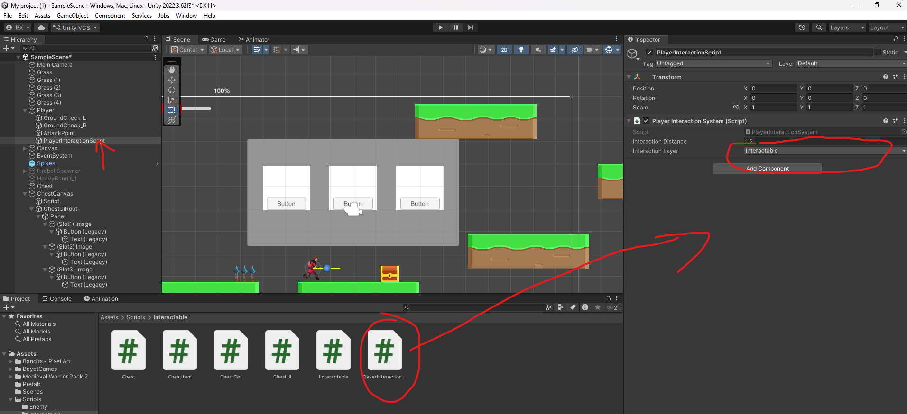

На об'єкт гравця (або дочірній об'єкт взаємодії) додайте `PlayerInteractionSystem`.

Для окремого дочірнього об'єкта натисніть **Create Empty** під Player і назвіть його **PlayerInteractionScript**:

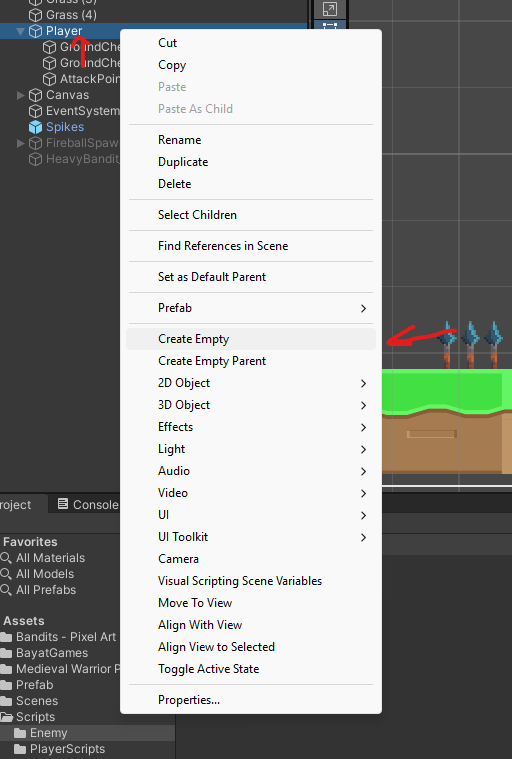

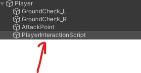

Заповніть:

- `Interaction Distance = 1.2`
- `Interaction Layer = Interactable`

### Крок 2. ChestSlot

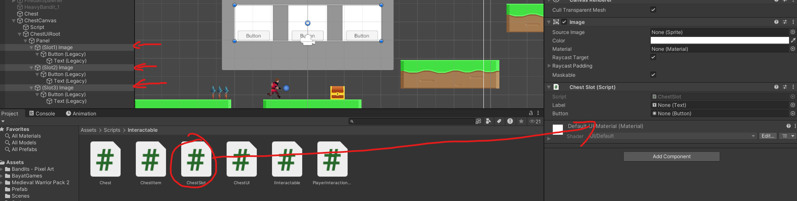

Для кожного `Slot Image` додайте `ChestSlot`.

Заповніть поля:

- `Label` -> `Text (Legacy)`
- `Button` -> `Button (Legacy)`

### Крок 3. ChestUI

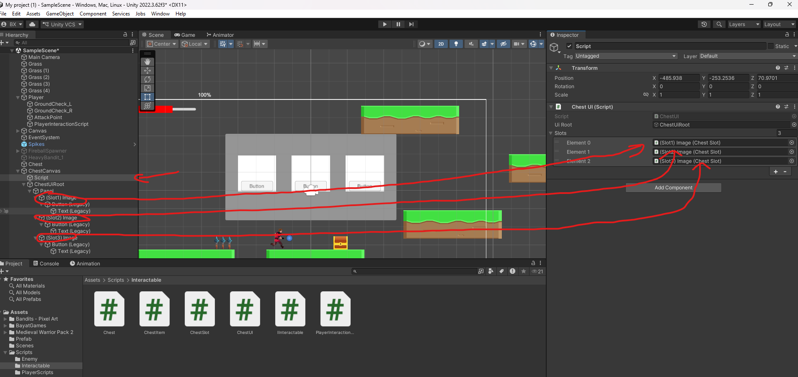

На об'єкті (наприклад `Script`) з компонентом `ChestUI` заповніть:

- `Ui Root` -> `ChestUiRoot`
- `Slots` -> усі 3 об'єкти слотів (`Slot1`, `Slot2`, `Slot3`)

---

## Частина 7. Додатково: заповнення `ChestSlot`

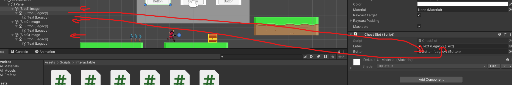

Повторіть налаштування `Label` і `Button` для кожного слота.

Приклад того, що буде у тексті кнопки після генерації:

- `HP +25`
- `Coins +40`
- `Power +3`

---

## Частина 8. Підключення `Chest` до скрині

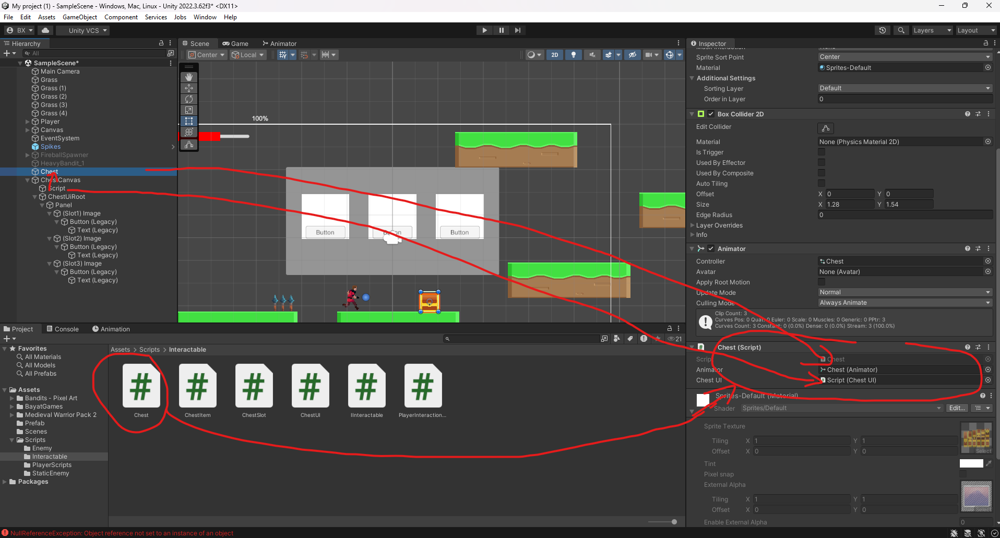

На об'єкт `Chest` додайте компонент `Chest (Script)`.

Заповніть:

- `Animator` -> `Chest (Animator)`
- `Chest UI` -> об'єкт із `ChestUI (Script)`

---

## Частина 9. Налаштування Animator

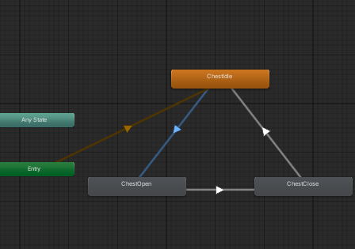

Перевірте стани в `Animator`:

- `ChestIdle`
- `ChestOpen`
- `ChestClose`

Налаштуйте переходи відповідно до вашої логіки відкриття.

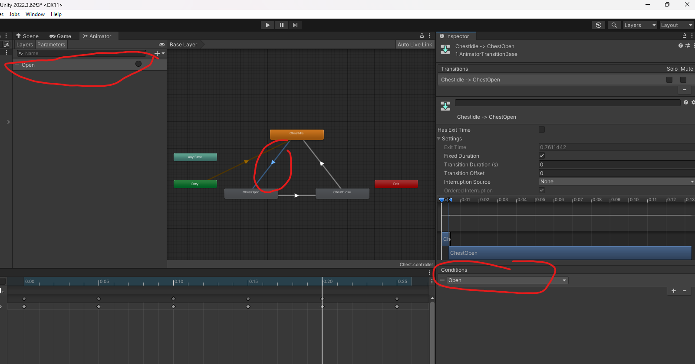

Якщо використовуєте параметр `Open`, перевірте:

- у `Parameters` є `Open`
- у `Conditions` переходу задано `Open = true`

---

## Перевірка роботи

1. Запустіть сцену
2. Підійдіть до скрині
3. Натисніть `E`
4. Перевірте відкриття анімації
5. Перевірте появу UI
6. Натисніть на один із 3 предметів
7. Переконайтесь, що ефект застосувався, а UI закрився

---

## Типові помилки

- Скриня не реагує на `E`:
перевірте `Layer = Interactable` і `Interaction Layer` у гравця

- UI не відкривається:
перевірте, чи в `Chest` заповнено поле `Chest UI`

- Кнопки не працюють:
перевірте `Label` і `Button` у кожному `ChestSlot`

- Бонуси не застосовуються:
перевірте на Player компоненти `PlayerHealt` і `PlayerAttack` (у вашій поточній реалізації)

---

## Домашня робота

- Додайте підказку `Press E to interact` біля скрині
- Зробіть різну рідкість нагород (`Common`, `Rare`, `Epic`)
- Додайте SFX відкриття скрині та SFX кліку по нагороді
